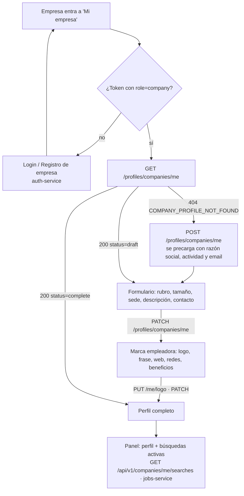

# Contrato frontend ↔ profile-service · Perfil de empresa

> **Para:** quien desarrolla el frontend (Integrante 4).
> **Servicio:** `profile-service` v0.2.0. Fuente de verdad: [`profile_service.openapi.json`](profile_service.openapi.json).
> **Base URL:** `/api/v1/profiles/companies` (va bajo `/profiles/` porque el gateway envía `/api/v1/companies/` a jobs-service).
> **Perfil de estudiante:** ver [`profile_frontend.md`](profile_frontend.md).

---

## 1. Qué hay en cada servicio

| Dato | Servicio | Cómo se obtiene |
|---|---|---|
| Razón social, CUIT, actividad, email de la cuenta | **auth-service** (se cargan en el registro) | `GET /api/v1/auth/me`. En el perfil vienen como copia de sólo lectura en `legal` |
| Nombre comercial, logo, rubro, tamaño, sede, descripción, links, beneficios, contacto de RR. HH., qué perfiles contrata | **profile-service** (este contrato) | `/api/v1/profiles/companies/...` |
| Búsquedas / ofertas de la empresa | **jobs-service** | `GET /api/v1/companies/me/searches` (ver [`jobs_frontend.md`](jobs_frontend.md)). **No forman parte del perfil**: el front las pide aparte y las muestra en la misma pantalla |

---

## 2. Flujo de pantallas



| Situación | Qué muestra el front |
|---|---|
| `GET /me` → `404 COMPANY_PROFILE_NOT_FOUND` | Botón "Completar el perfil de mi empresa" → `POST /me` (body opcional) |
| `status = "draft"` | Formulario en el paso con faltantes (`completion.missing`) |
| `status = "complete"` | Panel de la empresa + sus búsquedas (desde jobs-service) |
| Rol `student` en `/me` | `403 FORBIDDEN` (los estudiantes usan `/profiles/me`) |

---

## 3. Endpoints

Todos piden `Authorization: Bearer <JWT>` **salvo el logo**.

| Método y ruta | Quién | Para qué | OK |
|---|---|---|---|
| `GET /profiles/companies/me` | empresa | Mi perfil + completitud | `200` |
| `POST /profiles/companies/me` | empresa | Crear el perfil (body opcional con secciones) | `201` |
| `PATCH /profiles/companies/me` | empresa | Guardar secciones (cada sección se reemplaza completa) | `200` |
| `PUT /profiles/companies/me/logo` | empresa | Subir o reemplazar el logo (`multipart/form-data`, campo `file`) | `200` |
| `DELETE /profiles/companies/me/logo` | empresa | Quitar el logo | `204` |
| `GET /profiles/companies/{company_id}` | cualquier usuario logueado | Perfil público de una empresa (p. ej. desde una oferta) | `200` |
| `GET /profiles/companies/{company_id}/logo` | **público, sin token** | Imagen del logo para `` | `200` image |

- `company_id` es el `sub` de la empresa en auth-service: **el mismo `company_id` que traen las ofertas de jobs-service**. Desde una oferta se llega al perfil con `GET /profiles/companies/{job.company_id}`.
- `GET /profiles/companies` (listado) es interno: sólo servicio o admin.

---

## 4. Respuesta de `/me` (dueña)

```json
{
  "id": "comp-3f2a9c1b7e10",
  "company_id": "22222222-2222-4222-8222-000000000001",
  "version": 4,
  "status": "complete",
  "created_at": "2026-11-06T12:00:00+00:00",
  "updated_at": "2026-11-06T12:10:00+00:00",
  "legal": { "legal_name": "PampaTech S.A.", "cuit": "30712345678", "activity": "software" },
  "name": "PampaTech",
  "display_name": "PampaTech",
  "tagline": "Software a medida desde Buenos Aires",
  "description": "Desarrollamos productos digitales y formamos talento joven.",
  "industry": "software",
  "size": "51-200",
  "founded_year": 2015,
  "location": { "country": "AR", "province": "CABA", "city": "Buenos Aires" },
  "offices": [{ "country": "AR", "province": "Córdoba", "city": "Córdoba" }],
  "website": "https://pampatech.example.com",
  "links": [{ "type": "linkedin", "url": "https://linkedin.com/company/pampatech-ficticia" }],
  "contact": { "email": "rrhh@pampatech.example.com", "phone": "+54 11 4000-0000", "name": "Equipo de Talento", "public": false },
  "work_modalities": ["hybrid", "remote"],
  "benefits": ["prepaga", "días de estudio"],
  "values": ["aprendizaje continuo"],
  "hiring": { "areas": ["desarrollo backend"], "hires_students": true, "internship_program": true, "internship_agreements": ["UTN FRBA"] },
  "inclusive_hiring": { "accepts_disability_certificate": true, "accessible_workplace": true },
  "logo": { "mime_type": "image/png", "size_bytes": 18234, "uploaded_at": "2026-11-06T12:05:00+00:00" },
  "logo_url": "/api/v1/profiles/companies/22222222-2222-4222-8222-000000000001/logo?v=1793937568",
  "visibility": "public",
  "completion": {
    "origin": "RULES",
    "engine_version": "1.0.0",
    "percent": 100,
    "status": "complete",
    "can_generate_cv": false,
    "steps": [
      { "step": "company", "complete": true, "missing_required": 0, "missing_recommended": 0 },
      { "step": "branding", "complete": true, "missing_required": 0, "missing_recommended": 0 }
    ],
    "missing": []
  }
}
```

- `name` = `display_name` o, si está vacío, la razón social. Es el que se muestra en todo el sitio.
- `legal` viene de auth-service y **no se edita acá**. Se actualiza solo en cada guardado; si hay que corregirlo, es un trámite de auth-service.
- Los campos opcionales sin valor no vienen (no hay `null`). `can_generate_cv` no aplica a empresas: siempre es `false`.

### Alta (`POST /me`)

Se precarga sola con: `display_name` = razón social, `industry` = actividad declarada y `contact.email` = email de la cuenta. Se puede mandar un body con cualquier sección para guardar todo de una vez.

---

## 5. Completitud (badge verde "Calculado por reglas")

| Paso | Obligatorio | Recomendado |
|---|---|---|
| `company` | `display_name` (o razón social), `industry`, `location` (país, provincia, ciudad), `description`, `contact.email`, `size` | — |
| `branding` | — | `logo`, `tagline`, `website`, `links`, `benefits`, `hiring.areas` |

`status = "complete"` cuando no falta nada obligatorio. `percent` pondera obligatorios ×2 y recomendados ×1. `missing[].field` es la ruta del campo del formulario y `message` el texto a mostrar.

---

## 6. Guardar (`PATCH /me`)

Mandar sólo las secciones que cambian. **Cada sección se reemplaza entera** (si mandás `contact`, mandá todos sus campos).

Secciones editables: `display_name`, `tagline`, `description`, `industry`, `size`, `founded_year`, `location`, `offices`, `website`, `links`, `contact`, `work_modalities`, `benefits`, `values`, `hiring`, `inclusive_hiring`, `visibility`. Cualquier otra (`legal`, `cuit`, `logo`, …) → `422`.

| Campo | Regla |
|---|---|
| `display_name` | 2–120 caracteres |
| `tagline` | máx. 140 · `description` máx. 3000 |
| `industry`, `benefits[]`, `values[]`, `hiring.areas[]` | 1–80 caracteres por ítem (máx. 20 beneficios, 10 valores, 15 áreas) |
| `size` | `1-10`, `11-50`, `51-200`, `201-1000`, `1000+` |
| `founded_year` | 1800–2100 |
| `location`, `offices[]` | `{country (ISO alfa-2), province, city, postal_code?, zone?}` · **sin calle ni número** · máx. 20 sedes |
| `website`, `links[].url` | `http://` o `https://` · `links[].type`: `linkedin`, `instagram`, `x`, `facebook`, `youtube`, `github`, `other` |
| `contact` | `email?`, `phone?` (6–30: dígitos, espacios, `+ - ( )`), `name?`, `public` (default `false`) |
| `work_modalities[]` | `onsite`, `remote`, `hybrid` (informativo: la modalidad real va en cada oferta) |
| `visibility` | `public` (visible para estudiantes) · `hidden` (sólo la empresa, admin y servicios) |

---

## 7. Logo

```ts
const form = new FormData();
form.append('file', file); // PNG, JPEG o WebP · máx. 1 MB
await fetch('/api/v1/profiles/companies/me/logo', {
  method: 'PUT',
  headers: { Authorization: `Bearer ${token}` }, // sin Content-Type: lo arma el navegador
  body: form,
});
```

- El formato se valida **por el contenido del archivo**, no por la extensión. SVG y GIF se rechazan (`422 INVALID_LOGO`). Mayor a 1 MB → `422`.
- Se recomienda una imagen cuadrada de 256 × 256 a 512 × 512 px y fondo transparente o blanco. El servicio no recorta ni redimensiona: el front puede previsualizar y recortar antes de subir.
- Mostrar con ``. No necesita token; `?v=` cambia con cada subida, así que no hay problemas de caché.
- Sin logo: no vienen `logo` ni `logo_url`. Mostrar las iniciales de `name`.

---

## 8. Perfil público (`GET /profiles/companies/{company_id}`)

Lo que ve un estudiante (o cualquier usuario logueado que no sea la dueña):

```json
{
  "id": "comp-3f2a9c1b7e10",
  "company_id": "22222222-2222-4222-8222-000000000001",
  "name": "PampaTech",
  "display_name": "PampaTech",
  "legal_name": "PampaTech S.A.",
  "tagline": "Software a medida desde Buenos Aires",
  "description": "Desarrollamos productos digitales y formamos talento joven.",
  "industry": "software",
  "size": "51-200",
  "location": { "country": "AR", "province": "CABA", "city": "Buenos Aires" },
  "offices": [],
  "website": "https://pampatech.example.com",
  "links": [{ "type": "linkedin", "url": "https://linkedin.com/company/pampatech-ficticia" }],
  "work_modalities": ["hybrid", "remote"],
  "benefits": ["prepaga", "días de estudio"],
  "values": [],
  "hiring": { "areas": ["desarrollo backend"], "hires_students": true, "internship_program": true, "internship_agreements": [] },
  "logo_url": "/api/v1/profiles/companies/22222222-…/logo?v=1793937568",
  "updated_at": "2026-11-06T12:10:00+00:00"
}
```

- No incluye CUIT, `version`, `status`, `visibility` ni el detalle del archivo del logo.
- `contact` aparece sólo si la empresa marcó `contact.public = true`, y sin el flag `public`.
- Si la empresa puso `visibility = "hidden"` o no existe → `404 COMPANY_PROFILE_NOT_FOUND`.
- **Las ofertas de la empresa** se piden a jobs-service. Hoy jobs-service no tiene un filtro por empresa para estudiantes: se puede filtrar en el front el listado de ofertas activas por `company_id`, o pedir a jobs-service un `GET /api/v1/jobs?company_id=…` (pendiente de su lado).

---

## 9. Etiquetas sugeridas (es-AR)

| Enum | Valor → etiqueta |
|---|---|
| `size` | `1-10` 1 a 10 empleados · `11-50` 11 a 50 · `51-200` 51 a 200 · `201-1000` 201 a 1000 · `1000+` Más de 1000 |
| `visibility` | `public` Visible para estudiantes · `hidden` Oculto |
| `work_modalities` | `onsite` Presencial · `remote` Remota · `hybrid` Híbrida |
| `links[].type` | LinkedIn · Instagram · X · Facebook · YouTube · GitHub · Otro |
| `hiring` | `hires_students` Contrata estudiantes · `internship_program` Programa de pasantías · `internship_agreements` Convenios con universidades |
| `inclusive_hiring` | `accepts_disability_certificate` Acepta CUD · `accessible_workplace` Espacio de trabajo accesible |

---

## 10. Errores

Formato común `{"error": {"code", "message", "details"}}`.

| HTTP | `code` | Cuándo |
|---|---|---|
| 401 | `UNAUTHORIZED` | Sin token o token inválido (todas salvo el logo) |
| 403 | `FORBIDDEN` | Un usuario que no es empresa usa `/me` |
| 404 | `COMPANY_PROFILE_NOT_FOUND` | Sin perfil todavía · perfil oculto o inexistente |
| 404 | `LOGO_NOT_FOUND` | La empresa no tiene logo |
| 409 | `COMPANY_PROFILE_ALREADY_EXISTS` | `POST /me` con perfil existente (usar `PATCH`) |
| 422 | `INVALID_INPUT` | Validación (`details.errors[].loc`) o sección no editable |
| 422 | `INVALID_LOGO` | Formato no permitido, vacío o mayor a 1 MB |
