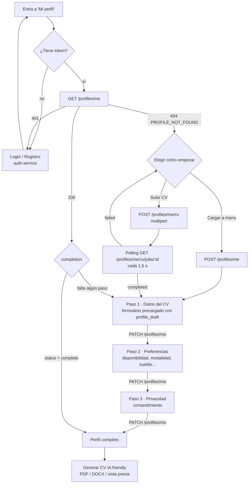
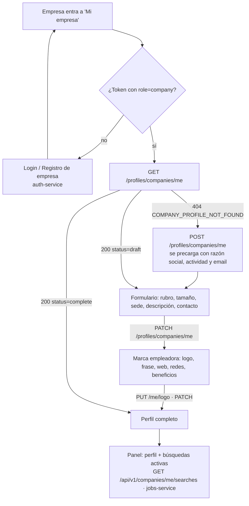

# Contrato · profile-service

> **Para:** el frontend (perfil de estudiante y de empresa), matching-service, mcp-tools y n8n, y jobs-service (snapshot de empresa).
> **Servicio:** `profile-service` 0.6.0 (FastAPI) · base `/api/v1/profiles`.
> **Fuente de verdad viva:** [Swagger UI](/api/v1/profiles/docs) · [ReDoc](/api/v1/profiles/redoc) · [OpenAPI](/api/v1/profiles/openapi.json) (por el gateway, en dev `http://localhost:8080`).
> **Partes:** A. Perfil del estudiante y CV (front) · B. Perfil de empresa (front) · C. Servicios: pool, vistas y eventos · D. Extracción de CV con n8n (WF-01) y endpoints de compatibilidad · E. Snapshot de empresa para jobs-service (propuesta) · Anexo · Estructura común perfil ↔ oferta ↔ match. Los `§` de cada parte se refieren a esa parte.
> Los documentos de los que sale este contrato están en [`historico/`](historico/). Todos los ejemplos usan datos ficticios.

---

## A. Perfil del estudiante y CV (frontend)

> Fuente: [`historico/profile_frontend.md`](historico/profile_frontend.md).

### 1. Flujo de pantallas



| Situación | Qué muestra el front |
|---|---|
| Sin token o `401` | Pedir login (auth-service). Volver a "Mi perfil" después. |
| `GET /me` → `404 PROFILE_NOT_FOUND` | Dos opciones: **Subir mi CV** (recomendado) o **Cargar mis datos a mano**. |
| `GET /me` → `200` y `completion.status = "draft"` | Retomar en el primer paso con `complete = false` (ver §5). |
| `GET /me` → `200` y `completion.status = "complete"` | Perfil listo. Ofrecer **Generar CV nuevo** (PDF o Word) y editar. |
| `completion.can_generate_cv = true` | Habilitar el botón de CV aunque falten preferencias (sólo pide el paso 1). |
| `has_cv_suggestions = true` | Hay una extracción de IA sin descartar: ofrecer "Ver datos detectados en tu CV". |

Sólo el rol `student` tiene perfil. Con `company` o `admin`, `/me` responde `403 FORBIDDEN`.

---

### 2. Autenticación

- Todas las rutas piden `Authorization: Bearer <access_token>` (el JWT de `POST /api/v1/auth/token`).
- Si el access token vence (`401`), usar `POST /api/v1/auth/token/refresh` y reintentar (lo resuelve el interceptor de `src/api/client.ts`).
- El perfil se identifica por el usuario del token: el front **no** manda `user_id` ni `profile_id` en las rutas `/me`.

---

### 3. Endpoints

| Método y ruta | Para qué | Respuesta OK |
|---|---|---|
| `GET /profiles/me` | Mi perfil + completitud | `200` `ProfileView` |
| `POST /profiles/me` | Crear el perfil a mano (body opcional, mismas secciones que PATCH) | `201` `ProfileView` |
| `PATCH /profiles/me` | Guardar secciones (cada sección enviada se **reemplaza completa**) | `200` `ProfileView` |
| `POST /profiles/me/cv` | Subir el CV (`multipart/form-data`, campo `file`) | `202` `CvJob` |
| `GET /profiles/me/cv/jobs/{job_id}` | Progreso y resultado de la extracción | `200` `CvJob` |
| `GET /profiles/me/cv-suggestions` | Última extracción de IA guardada | `200` `CvResult` |
| `DELETE /profiles/me/cv-suggestions` | Descartar la extracción | `204` |
| `GET /profiles/me/cv.pdf` | CV nuevo en PDF (`?inline=true` para abrir en el navegador; `?layout=` para forzar un diseño) | `200` `application/pdf` |
| `GET /profiles/me/cv.docx` | CV nuevo en Word (`?layout=` opcional) | `200` `application/vnd.openxmlformats-officedocument.wordprocessingml.document` |
| `GET /profiles/me/cv.html` | Vista previa del CV (mismo diseño que el PDF; `?layout=` opcional) | `200` `text/html` |
| `GET /profiles/me/cv-design` | Diseño del CV: el que rige, el de reglas, el de IA y el catálogo (§8.1) | `200` `CvDesignView` |
| `POST /profiles/me/cv-design/requests` | Pedir a la IA (WF-07) el diseño más adecuado, en segundo plano | `202` `CvDesignView` |
| `PUT /profiles/me/cv-design` | Elegir un diseño (`{"layout": "cronologico"}`) o volver al automático (`{"layout": null}`) | `200` `CvDesignView` |

> No usar desde el front: `GET /profiles` y `GET /profiles/{id}` (internos para matching y admin) ni `/profiles/cv-extract*` (compatibilidad con la página de prueba `/profiles/cv-test`).

---

### 4. `ProfileView` (respuesta de `GET`, `POST` y `PATCH /me`)

Es el perfil de la estructura común §5 más dos campos calculados. Los campos opcionales **sin valor no vienen** en el JSON (no hay `null`).

```json
{
  "id": "prof-ef0b380e927d",
  "user_id": "f110bd46-96c8-4ad1-8bea-9ee3660f0b7a",
  "version": 3,
  "status": "complete",
  "created_at": "2026-11-06T03:31:24+00:00",
  "updated_at": "2026-11-06T03:35:10+00:00",
  "personal": {
    "name": "Lucía Fernández",
    "email": "lucia.ficticia@example.com",
    "phone": "+54 11 5555-0000",
    "location": { "country": "AR", "province": "Buenos Aires", "city": "San Isidro" }
  },
  "headline": "Estudiante de Sistemas · Backend Python",
  "summary": "Desarrolladora backend en formación, con foco en APIs REST.",
  "academic_status": { "institution": "UTN FRBA", "career": "Ingeniería en Sistemas de Información", "current_year": 4, "progress_percent": 70, "student_shift": ["evening"] },
  "target": { "roles": ["Desarrolladora backend"], "areas": [], "seniority": "junior" },
  "work_conditions": {
    "work_schedule": ["part_time"],
    "work_modality": ["hybrid", "remote"],
    "employment_type": ["employee", "internship"],
    "contract_duration": [],
    "weekly_hours": { "min": 20, "max": 30 },
    "shifts": [],
    "availability_start": "immediate",
    "salary": { "min": 600000, "max": 750000, "currency": "ARS", "period": "month", "gross": true, "negotiable": false, "visibility": "on_match", "to_agree": false },
    "willing_to_relocate": false,
    "driver_license": [],
    "work_authorization": []
  },
  "skills": [
    { "name": "Python", "normalized": "python", "level": 4, "category": "hard", "source": "cv_ai", "confirmed": true },
    { "name": "Git", "normalized": "git", "level": 3, "category": "tool", "source": "manual", "confirmed": true }
  ],
  "experience": [
    { "company": "FinTech Ficticia", "role": "Desarrolladora Backend", "start": "2025-03", "end": "actual", "description": "- APIs REST con FastAPI", "skills_used": ["FastAPI"], "months": 21 }
  ],
  "education": [
    { "institution": "UTN FRBA", "degree": "Ingeniería en Sistemas de Información", "level": "university", "status": "in_progress", "start": "2022" }
  ],
  "languages": [{ "name": "Inglés", "normalized": "ingles", "level": "B2" }],
  "certifications": [{ "name": "Curso de Docker Ficticio", "issuer": "Academia Demo", "year": 2025 }],
  "projects": [],
  "links": [{ "type": "github", "url": "https://github.com/lucia-ficticia" }],
  "volunteering": [],
  "references_available": false,
  "visibility": "public_to_companies",
  "job_search_status": "active",
  "consents": { "data_processing": true, "ai_processing": true, "contact_by_email": false, "accepted_at": "2026-11-06T03:35:10+00:00" },
  "cv_files": [{ "stored_filename": "9f1c…e2.pdf", "original_filename": "mi_cv.pdf", "mime_type": "application/pdf", "size_bytes": 74820, "uploaded_at": "2026-11-06T03:32:00+00:00" }],
  "has_cv_suggestions": true,
  "completion": { "…": "ver §5" }
}
```

Campos que **calcula el servicio** (no se mandan, se ignoran si vienen en el formulario): `id`, `user_id`, `version`, `status`, `created_at`, `updated_at`, `skills[].normalized`, `languages[].normalized`, `experience[].months`, `cv_files`, `has_cv_suggestions`, `completion`.

Al guardar, el servicio también:
- reemplaza el nombre de la skill por el del catálogo si lo reconoce (`"python3"` → `"Python"`, `"Postgres"` → `"PostgreSQL"`) y completa `category` si falta;
- unifica skills repetidas (gana la primera);
- pone `consents.accepted_at` si `data_processing = true` y no vino la fecha.

---

### 5. Completitud (`completion`, calculado por reglas)

Mostrarlo con el badge verde **"Calculado por reglas"** (`origin: "RULES"`). No es IA.

```json
"completion": {
  "origin": "RULES",
  "engine_version": "1.0.0",
  "percent": 72,
  "status": "draft",
  "can_generate_cv": true,
  "steps": [
    { "step": "cv", "complete": true, "missing_required": 0, "missing_recommended": 2 },
    { "step": "preferences", "complete": false, "missing_required": 2, "missing_recommended": 1 },
    { "step": "privacy", "complete": false, "missing_required": 1, "missing_recommended": 0 }
  ],
  "missing": [
    { "field": "work_conditions.work_modality", "step": "preferences", "required": true, "message": "Elegí la presencialidad que aceptás (presencial, remota, mixta)" },
    { "field": "personal.phone", "step": "cv", "required": false, "message": "Agregá un teléfono" }
  ]
}
```

| Paso | Obligatorio (`required: true`) | Recomendado |
|---|---|---|
| `cv` | `personal.name`, `personal.email`, `personal.location` (país, provincia y ciudad), `summary`, `skills` (≥ 1), `education` (≥ 1 o `academic_status.career`) | `headline`, `personal.phone`, `experience` (o `projects`), `languages`, `links` |
| `preferences` | `work_conditions.work_modality`, `work_schedule`, `employment_type`, `availability_start` | `target.roles`, `work_conditions.weekly_hours`, `work_conditions.salary` |
| `privacy` | `consents.data_processing = true` | — |

- `status = "complete"` cuando no falta nada obligatorio. Sólo los perfiles completos, visibles y buscando trabajo entran al matching.
- `can_generate_cv = true` cuando el paso `cv` está completo.
- `percent`: obligatorios pesan 2 y recomendados 1. Sirve para la barra de progreso.
- `missing[].field` usa la misma ruta que el formulario: sirve para marcar el campo y mostrar `message`.

---

### 6. Subir el CV y precargar el formulario

#### 6.1 Subida

```ts
const form = new FormData();
form.append('file', file); // .pdf, .docx, .doc o .md · máx. 5 MB
const job = await fetch('/api/v1/profiles/me/cv', {
  method: 'POST',
  headers: { Authorization: `Bearer ${token}` }, // NO poner Content-Type: lo arma el navegador
  body: form,
}).then((r) => r.json());
```

- Si el estudiante no tenía perfil, se crea en borrador con el email de su cuenta.
- Respuesta `202`: un `CvJob` con `status: "processing"`.
- Errores: `422 INVALID_CV_FILE` (extensión, MIME, vacío o > 5 MB) con el formato común.

#### 6.2 Polling

`GET /profiles/me/cv/jobs/{job_id}` cada **1,5 s** hasta que `status` deje de ser `processing` (la IA tarda entre 10 y 60 s).

```json
{
  "job_id": "cvjob-28b5e7380371",
  "status": "processing",
  "stage": "Estructurando competencias, experiencia, educación e idiomas con Agente IA…",
  "step_index": 3,
  "progress_percent": 54,
  "elapsed_seconds": 12.4,
  "profile_id": "prof-ef0b380e927d",
  "filename": "mi_cv.pdf",
  "result": null,
  "error": null
}
```

- `progress_percent`, `stage` y `step_index` (1–4) sirven para la barra de progreso.
- `status: "failed"` → `error: {code, message, details}`; ofrecer reintentar o cargar a mano. Ej.: `CV_WEBHOOK_ERROR` si n8n no responde.
- Un `job_id` de otro usuario responde `404`.

#### 6.3 Resultado (`status: "completed"`)

`result` (también disponible en `GET /profiles/me/cv-suggestions`) es contenido de IA: mostrarlo con el badge ámbar **"Sugerido por IA"** y el `disclaimer`.

```json
"result": {
  "origin": "AI",
  "model": "nvidia/nemotron-3-ultra-550b-a55b",
  "prompt_version": "1.1.0",
  "generated_at": "2026-11-06T03:32:30+00:00",
  "verified": true,
  "disclaimer": "Sugerencias extraídas automáticamente por IA del CV subido…",
  "file": { "filename": "mi_cv.pdf", "format": "pdf", "size_bytes": 74820 },
  "cv_suggestions": { "…": "forma cv_standard, tal como la devolvió n8n" },
  "profile_draft": {
    "personal": {
      "name": "Lucía Fernández",
      "email": "lucia.ficticia@example.com",
      "phone": "COMPLETAR_MANUALMENTE",
      "location": { "country": "AR", "province": "Buenos Aires", "city": "San Isidro" }
    },
    "headline": "Desarrolladora backend · Python y FastAPI",
    "summary": "Desarrolladora backend con Python, FastAPI y Docker.",
    "skills": [
      { "name": "Python", "normalized": "python", "level": 4, "category": "hard", "source": "cv_ai", "confirmed": false },
      { "name": "Docker", "normalized": "docker", "level": "COMPLETAR_MANUALMENTE", "category": "tool", "source": "cv_ai", "confirmed": false }
    ],
    "experience": [
      { "company": "FinTech Ficticia", "role": "Desarrolladora Backend", "start": "2024-03", "end": "actual", "description": "- Microservicios REST", "skills_used": ["FastAPI", "PostgreSQL"] }
    ],
    "education": [
      { "institution": "Universidad Tecnológica Nacional", "degree": "Ingeniería en Sistemas de Información", "level": "university", "status": "in_progress" }
    ],
    "languages": [{ "name": "Inglés", "normalized": "ingles", "level": "B2" }],
    "certifications": [{ "name": "Curso de Docker Ficticio" }],
    "links": [{ "type": "github", "url": "https://github.com/lucia-ficticia" }],
    "academic_status": { "institution": "Universidad Tecnológica Nacional", "career": "Ingeniería en Sistemas de Información" }
  },
  "review_fields": ["personal.phone", "skills[1].level"],
  "suggested_fields": ["headline"],
  "received_at": "2026-11-06T03:32:31+00:00"
}
```

Cómo usarlo:

1. **Precargar el formulario del paso 1 con `profile_draft`**, que ya tiene la forma del PATCH: país ISO, enums válidos, fechas `YYYY-MM` y skills normalizadas.
2. **`"COMPLETAR_MANUALMENTE"`** marca un dato que la IA no encontró. Mostrar el campo vacío y resaltado; `review_fields` lista esas rutas.
   **`suggested_fields`** (desde 0.6.0) lista lo que la IA no copió del CV sino que sugirió con su contenido: hoy sólo `headline`, cuando el CV no tiene un título y la IA arma uno con la carrera, los puestos y las competencias del CV. Viene precargado; mostrarlo con un aviso de "sugerido por la IA, revisalo". Si el CV tiene título, `headline` viene precargado y no está en ninguna de las dos listas.
3. Cada ítem sugerido (skill, experiencia, idioma…) se puede **aceptar, editar o descartar**. Al aceptar una skill, mandar `source: "cv_ai"`; las que agrega el usuario van con `source: "manual"`.
4. Guardar con `PATCH /profiles/me`. **Si queda algún `"COMPLETAR_MANUALMENTE"` en lo enviado, el servicio responde `422`** con las rutas en `details.fields`.
5. La extracción **nunca pisa** el perfil: sólo se guarda lo que el usuario confirma con PATCH.
6. Si el usuario elige "No usar estos datos": `DELETE /profiles/me/cv-suggestions`.

Datos que el CV no trae y se piden siempre en el paso 2: presencialidad, modalidad horaria, tipo de empleo, disponibilidad, sueldo pretendido, horas, turnos, etc.

---

### 7. Guardar (`PATCH /profiles/me`)

- Mandar **sólo las secciones que cambian**. Cada sección enviada **se reemplaza entera**: si mandás `personal`, mandá todos sus campos (si omitís `phone`, se borra). Las listas (`skills`, `experience`…) también se reemplazan completas.
- Secciones editables: `personal`, `headline`, `summary`, `academic_status`, `target`, `work_conditions`, `skills`, `experience`, `education`, `languages`, `certifications`, `projects`, `links`, `volunteering`, `references_available`, `visibility`, `job_search_status`, `consents`, `inclusion`.
- Campos desconocidos → `422` (`extra_forbidden`).

Ejemplo del paso 2 (preferencias):

```json
{
  "target": { "roles": ["Desarrolladora backend"], "seniority": "junior" },
  "work_conditions": {
    "work_schedule": ["part_time"],
    "work_modality": ["hybrid", "remote"],
    "hybrid_onsite_days": 2,
    "employment_type": ["employee", "internship"],
    "weekly_hours": { "min": 20, "max": 30 },
    "shifts": ["morning", "afternoon"],
    "availability_start": "immediate",
    "max_commute_km": 25,
    "salary": { "min": 600000, "max": 750000, "currency": "ARS", "period": "month", "negotiable": true, "visibility": "on_match" }
  }
}
```

Paso 3 (privacidad): `{ "consents": { "data_processing": true, "ai_processing": true, "contact_by_email": false } }`.

#### 7.1 Validaciones (las mismas conviene hacerlas con Zod en el front)

| Campo | Regla |
|---|---|
| `personal.name` | 2–120 caracteres |
| `personal.email` | email válido |
| `personal.phone` | 6–30 caracteres: dígitos, espacios, `+ - ( )` |
| `personal.birth_year` | 1940–2015 (opcional; no sale en el CV) |
| `personal.location.country` | ISO-3166 alfa-2 en mayúsculas (`AR`) |
| `skills[].level` | entero 1–5 (máx. 60 skills) |
| `experience[].start` / `education[].start` / `end` | `YYYY` o `YYYY-MM`; `experience[].end` también acepta `"actual"` |
| `academic_status.progress_percent` | 0–100 · `current_year` 1–8 |
| `work_conditions.hybrid_onsite_days` | 0–5 |
| `work_conditions.weekly_hours` | `1 ≤ min ≤ max ≤ 80` |
| `work_conditions.salary` | si `to_agree = false`: `min`, `currency` y `period` obligatorios y `max ≥ min`. Con `to_agree = true` no hace falta monto ("A convenir") |
| URLs (`links`, `projects`, `certifications`) | `http://` o `https://` |
| `summary` | máx. 2000 · `headline` máx. 140 · descripciones máx. 4000 |

`inclusion` (certificado de discapacidad, necesidades de accesibilidad) es **opcional y privado**: sólo lo ve el estudiante, no va al CV, ni a empresas ni a la IA. Pedir consentimiento explícito antes de mostrar ese bloque.

---

### 8. Generar el CV "IA friendly" (PDF o Word)

Disponible cuando `completion.can_generate_cv = true`; si no, `409 PROFILE_INCOMPLETE` con `details.missing`. Se arma **por reglas** con lo que el estudiante confirmó (no usa IA ni inventa nada) y siempre refleja el último guardado.

**Diseño:** clásico y profesional (estilo de las plantillas Harvard y "Jake's Resume"), A4, una columna, tipografía Inter, texto casi negro y un solo acento azul marino en el encabezado y los títulos, sin fondos de color. Lo pueden leer bien los ATS y los filtros con IA:
- todo el contenido es texto real (sin imágenes, tablas ni columnas), con títulos estándar: Perfil profesional, Competencias, Experiencia, Proyectos, Educación, Idiomas, Certificaciones, Voluntariado. El orden depende del diseño (§8.1);
- competencias en **una línea de texto por categoría, separadas por comas** ("Técnicas: Python (avanzado), PostgreSQL, React"), sin chips ni barras; el nivel sólo se aclara si es avanzado o experto. Idiomas con nivel explícito ("Inglés — B2 · Intermedio alto") y fechas uniformes ("mar. 2025 – Actualidad");
- metadatos del archivo con autor y palabras clave (skills, puestos buscados e idiomas); el PDF es etiquetado (PDF/UA) y el Word usa estilos nativos (Título, Encabezado 1, Viñetas).

No incluye: año de nacimiento, datos de inclusión, sueldo pretendido ni consentimientos. Incluye email, teléfono, ciudad/provincia/país, links y una línea de **Disponibilidad** (modalidad, horario, tipo de empleo, inicio).

Las descargas necesitan el header `Authorization`, así que no sirve un `<a href>` directo:

```ts
async function downloadCv(format: 'pdf' | 'docx') {
  const res = await fetch(`/api/v1/profiles/me/cv.${format}`, {
    headers: { Authorization: `Bearer ${token}` },
  });
  if (!res.ok) throw await res.json(); // 409 PROFILE_INCOMPLETE → mostrar details.missing
  const name = /filename="(.+)"/.exec(res.headers.get('Content-Disposition') ?? '')?.[1] ?? `CV.${format}`;
  const url = URL.createObjectURL(await res.blob());
  const a = Object.assign(document.createElement('a'), { href: url, download: name });
  a.click();
  URL.revokeObjectURL(url);
}
```

- Nombre del archivo: `CV_Nombre_Apellido.pdf` / `.docx` (sin acentos).
- **Vista previa:** `GET /profiles/me/cv.html` → `<iframe sandbox srcdoc={html}>` (el HTML es autocontenido).
- El PDF también se puede abrir en otra pestaña con `GET /profiles/me/cv.pdf?inline=true` (vía blob URL).
- Cada descarga trae el header `X-Cv-Layout` con el id del diseño con que se generó.

#### 8.1 Diseño del CV (desde 0.5.0)

Hay tres diseños. Todos son ATS-friendly: una columna, texto real y títulos estándar. Sólo cambia **el orden de las secciones**:

| `id` | Nombre | Cuándo conviene | Orden |
|---|---|---|---|
| `cronologico` | Cronológico | Ya tiene experiencia laboral relevante | perfil → experiencia → proyectos → educación → competencias → certificaciones → idiomas → voluntariado |
| `primer_empleo` | Primer empleo | Poca o ninguna experiencia | perfil → educación → proyectos → competencias → experiencia → voluntariado → certificaciones → idiomas |
| `competencias` | Por competencias | Perfil técnico con muchas competencias y proyectos o certificaciones | perfil → competencias → proyectos → experiencia → certificaciones → educación → idiomas → voluntariado |

**Quién elige el diseño (`effective.source`), de mayor a menor prioridad:**
1. `user`: el que eligió el estudiante con `PUT /me/cv-design`.
2. `ai`: la última sugerencia del agente `cv_designer` (WF-07), si terminó bien, es del catálogo y **el perfil no cambió** desde que se pidió (si cambió, `stale: true` y no rige).
3. `rules`: la elección por reglas. Siempre hay una (`origin: "RULES"`, `engine_version`):
   - ≥ 12 meses de experiencia o ≥ 2 puestos → `cronologico`;
   - si no, ≥ 8 competencias y ≥ 2 proyectos o certificaciones → `competencias`;
   - si no → `primer_empleo`.

**Pedir la sugerencia a la IA** (`POST /me/cv-design/requests` → `202`):
- Requiere `consents.ai_processing = true` (si no, `409 AI_CONSENT_REQUIRED`) y el paso 1 completo (si no, `409 PROFILE_INCOMPLETE`).
- Corre en segundo plano. El front consulta `GET /me/cv-design` hasta que `ai_recommendation.status` deje de ser `processing`. Si ya hay un pedido en curso no se repite; un pedido que sigue en curso a los 10 min se muestra como `failed`.
- La IA recibe sólo un **resumen sin datos personales**: cantidad y meses de experiencia, puestos, cantidad de proyectos, certificaciones y estudios, competencias principales, carrera y puestos buscados. Nunca recibe nombre, contacto, empresas, fechas exactas ni sueldo.
- profile-service vuelve a validar la respuesta: un diseño fuera del catálogo queda como `failed` y las secciones desconocidas o repetidas se descartan.

**`CvDesignView`:**

```json
{
  "profile_id": "prof-…",
  "effective": { "id": "primer_empleo", "name": "Primer empleo", "description": "…", "best_for": "…",
                 "section_order": ["summary", "education", "projects", "skills", "experience", "volunteering", "certifications", "languages"],
                 "source": "ai" },
  "rule_based": { "origin": "RULES", "engine_version": "cv-layout-1.0.0", "layout": "cronologico",
                  "section_order": ["summary", "experience", "…"], "reasons": ["Tenés 21 meses de experiencia en 1 puesto(s): …"] },
  "ai_recommendation": { "origin": "AI", "status": "completed", "request_id": "cvd-…", "requested_at": "…",
                         "layout": "primer_empleo", "section_order": ["summary", "education", "…"],
                         "rationale": "…", "model": "…", "prompt_version": "1.0.0", "generated_at": "…",
                         "disclaimer": "…", "stale": false, "error": null },
  "user_choice": null,
  "catalog": [{ "id": "cronologico", "name": "Cronológico", "description": "…", "best_for": "…", "section_order": ["…"] }]
}
```

- `ai_recommendation` es `null` hasta el primer pedido. `status`: `processing` | `completed` | `failed` (con `error`).
- `user_choice`: `null` o `{ "layout", "chosen_at" }`.
- En el front: el diseño por reglas con el badge verde "Calculado por reglas" y la sugerencia de la IA con el badge ámbar "Sugerido por IA" y su `disclaimer`, en paneles separados.

---

### 9. Enums y etiquetas sugeridas (es-AR)

| Enum | Valor → etiqueta |
|---|---|
| `work_schedule` | `full_time` Full time · `part_time` Part time · `hourly` Por horas · `flexible` Flexible |
| `work_modality` | `onsite` Presencial · `remote` Remota · `hybrid` Mixta / híbrida |
| `employment_type` | `employee` Relación de dependencia · `freelance` Freelance · `internship` Pasantía · `trainee` Programa trainee |
| `contract_duration` | `permanent` Indeterminado · `fixed_term` Plazo fijo · `project` Por proyecto · `seasonal` Temporada |
| `availability_start` | `immediate` Inmediata · `within_15_days` En 15 días · `within_30_days` En 30 días · `to_agree` A convenir |
| `shift` | `morning` Mañana · `afternoon` Tarde · `evening` Vespertino · `night` Noche · `weekend` Fin de semana · `rotating` Rotativo |
| `seniority` | `no_experience` Sin experiencia · `trainee` Trainee · `junior` Junior · `semi_senior` Semi senior · `senior` Senior |
| `skill level` | 1 Inicial · 2 Básico · 3 Intermedio · 4 Avanzado · 5 Experto |
| `skill category` | `hard` Técnica · `tool` Herramienta · `methodology` Metodología · `soft` Interpersonal |
| `language level` | `A1`…`C2` (MCER) · `native` Nativo |
| `education level` | `secondary` Secundario · `tertiary` Terciario · `university` Universitario · `postgraduate` Posgrado · `course` Curso |
| `education status` | `in_progress` En curso · `completed` Completo · `incomplete` Incompleto |
| `currency` / `period` | `ARS`, `USD` · `hour` por hora · `day` por día · `month` por mes · `year` por año · `project` por proyecto |
| `salary.visibility` | `public` Visible para empresas · `on_match` Sólo si hay match · `hidden` Oculto (sólo lo usa el motor) |
| `travel_availability` | `none` No · `occasional` Ocasional · `frequent` Frecuente |
| `invoicing_status` | `monotributo` · `responsable_inscripto` · `none` No factura · `to_register` Puede inscribirse |
| `link type` | `linkedin` · `github` · `portfolio` · `other` |
| `visibility` (perfil) | `public_to_companies` Visible para empresas · `only_applied` Sólo donde me postulo · `hidden` Oculto |
| `job_search_status` | `active` Buscando · `open_to_offers` Abierto a ofertas · `not_looking` No busco |

---

### 10. Errores

Siempre `{"error": {"code", "message", "details"}}`.

| HTTP | `code` | Cuándo | Qué hacer |
|---|---|---|---|
| 401 | `UNAUTHORIZED` | Sin token, vencido o inválido | Refresh o login |
| 401 | `ACCOUNT_DELETED` | Un admin dio de baja la cuenta y el access token todavía no venció (hasta 15 min) | Cerrar la sesión y volver al home |
| 403 | `FORBIDDEN` | Rol distinto de `student` en `/me` | Ocultar la sección |
| 404 | `PROFILE_NOT_FOUND` | Todavía no tiene perfil · job ajeno | Ofrecer CV o carga manual |
| 404 | `CV_SUGGESTIONS_NOT_FOUND` | No hay extracción guardada | — |
| 404 | `CV_JOB_NOT_FOUND` | `job_id` inexistente (p. ej. reinicio del servicio) | Volver a subir |
| 409 | `PROFILE_ALREADY_EXISTS` | `POST /me` con perfil existente | Usar `PATCH` |
| 409 | `PROFILE_INCOMPLETE` | Generar CV o pedir el diseño a la IA sin el paso 1 completo | Mostrar `details.missing` |
| 409 | `AI_CONSENT_REQUIRED` | Pedir el diseño a la IA sin `consents.ai_processing` | Ofrecer el paso de privacidad |
| 422 | `UNKNOWN_CV_LAYOUT` | `layout` fuera del catálogo (`PUT /me/cv-design` o `?layout=`) | — |
| 422 | `INVALID_INPUT` | Validación (`details.errors[].loc` = ruta del campo) o `COMPLETAR_MANUALMENTE` sin reemplazar (`details.fields`) | Marcar campos |
| 422 | `INVALID_CV_FILE` | Archivo no permitido o > 5 MB | Mensaje junto al input |
| 422 | `UNSUPPORTED_FORMAT` | Formato de CV desconocido | — |

Ejemplo de `422` de validación:

```json
{ "error": { "code": "INVALID_INPUT", "message": "Datos de entrada inválidos",
  "details": { "errors": [ { "loc": ["body", "work_conditions", "work_modality", 0], "msg": "Input should be 'onsite', 'remote' or 'hybrid'", "type": "enum" } ] } } }
```

---

## B. Perfil de empresa (frontend)

> Fuente: [`historico/company_profile_frontend.md`](historico/company_profile_frontend.md).

### 1. Qué hay en cada servicio

| Dato | Servicio | Cómo se obtiene |
|---|---|---|
| Razón social, CUIT, actividad, email de la cuenta | **auth-service** (se cargan en el registro) | `GET /api/v1/auth/me`. En el perfil vienen como copia de sólo lectura en `legal` |
| Nombre comercial, logo, rubro, tamaño, sede, descripción, links, beneficios, contacto de RR. HH., qué perfiles contrata | **profile-service** (este contrato) | `/api/v1/profiles/companies/...` |
| Búsquedas / ofertas de la empresa | **jobs-service** | `GET /api/v1/companies/me/searches` (ver [`jobs.md`](jobs.md)). **No forman parte del perfil**: el front las pide aparte y las muestra en la misma pantalla |

---

### 2. Flujo de pantallas



| Situación | Qué muestra el front |
|---|---|
| `GET /me` → `404 COMPANY_PROFILE_NOT_FOUND` | Botón "Completar el perfil de mi empresa" → `POST /me` (body opcional) |
| `status = "draft"` | Formulario en el paso con faltantes (`completion.missing`) |
| `status = "complete"` | Panel de la empresa + sus búsquedas (desde jobs-service) |
| Rol `student` en `/me` | `403 FORBIDDEN` (los estudiantes usan `/profiles/me`) |

---

### 3. Endpoints

Todos piden `Authorization: Bearer <JWT>` **salvo el logo**.

| Método y ruta | Quién | Para qué | OK |
|---|---|---|---|
| `GET /profiles/companies/me` | empresa | Mi perfil + completitud | `200` |
| `POST /profiles/companies/me` | empresa | Crear el perfil (body opcional con secciones) | `201` |
| `PATCH /profiles/companies/me` | empresa | Guardar secciones (cada sección se reemplaza completa) | `200` |
| `PUT /profiles/companies/me/logo` | empresa | Subir o reemplazar el logo (`multipart/form-data`, campo `file`) | `200` |
| `DELETE /profiles/companies/me/logo` | empresa | Quitar el logo | `204` |
| `GET /profiles/companies/{company_id}` | cualquier usuario logueado | Perfil público de una empresa (p. ej. desde una oferta) | `200` |
| `GET /profiles/companies/{company_id}/logo` | **público, sin token** | Imagen del logo para `` | `200` image |

- `company_id` es el `sub` de la empresa en auth-service: **el mismo `company_id` que traen las ofertas de jobs-service**. Desde una oferta se llega al perfil con `GET /profiles/companies/{job.company_id}`.
- `GET /profiles/companies` (listado) es interno: sólo servicio o admin.

---

### 4. Respuesta de `/me` (dueña)

```json
{
  "id": "comp-3f2a9c1b7e10",
  "company_id": "22222222-2222-4222-8222-000000000001",
  "version": 4,
  "status": "complete",
  "created_at": "2026-11-06T12:00:00+00:00",
  "updated_at": "2026-11-06T12:10:00+00:00",
  "legal": { "legal_name": "PampaTech S.A.", "cuit": "30712345678", "activity": "software" },
  "name": "PampaTech",
  "display_name": "PampaTech",
  "tagline": "Software a medida desde Buenos Aires",
  "description": "Desarrollamos productos digitales y formamos talento joven.",
  "industry": "software",
  "size": "51-200",
  "founded_year": 2015,
  "location": { "country": "AR", "province": "CABA", "city": "Buenos Aires" },
  "offices": [{ "country": "AR", "province": "Córdoba", "city": "Córdoba" }],
  "website": "https://pampatech.example.com",
  "links": [{ "type": "linkedin", "url": "https://linkedin.com/company/pampatech-ficticia" }],
  "contact": { "email": "rrhh@pampatech.example.com", "phone": "+54 11 4000-0000", "name": "Equipo de Talento", "public": false },
  "work_modalities": ["hybrid", "remote"],
  "benefits": ["prepaga", "días de estudio"],
  "values": ["aprendizaje continuo"],
  "hiring": { "areas": ["desarrollo backend"], "hires_students": true, "internship_program": true, "internship_agreements": ["UTN FRBA"] },
  "inclusive_hiring": { "accepts_disability_certificate": true, "accessible_workplace": true },
  "logo": { "mime_type": "image/png", "size_bytes": 18234, "uploaded_at": "2026-11-06T12:05:00+00:00" },
  "logo_url": "/api/v1/profiles/companies/22222222-2222-4222-8222-000000000001/logo?v=1793937568",
  "visibility": "public",
  "completion": {
    "origin": "RULES",
    "engine_version": "1.0.0",
    "percent": 100,
    "status": "complete",
    "can_generate_cv": false,
    "steps": [
      { "step": "company", "complete": true, "missing_required": 0, "missing_recommended": 0 },
      { "step": "branding", "complete": true, "missing_required": 0, "missing_recommended": 0 }
    ],
    "missing": []
  }
}
```

- `name` = `display_name` o, si está vacío, la razón social. Es el que se muestra en todo el sitio.
- `legal` viene de auth-service y **no se edita acá**. Se actualiza solo en cada guardado; si hay que corregirlo, es un trámite de auth-service.
- Los campos opcionales sin valor no vienen (no hay `null`). `can_generate_cv` no aplica a empresas: siempre es `false`.

#### Alta (`POST /me`)

Se precarga sola con: `display_name` = razón social, `industry` = actividad declarada y `contact.email` = email de la cuenta. Se puede mandar un body con cualquier sección para guardar todo de una vez.

---

### 5. Completitud (badge verde "Calculado por reglas")

| Paso | Obligatorio | Recomendado |
|---|---|---|
| `company` | `display_name` (o razón social), `industry`, `location` (país, provincia, ciudad), `description`, `contact.email`, `size` | — |
| `branding` | — | `logo`, `tagline`, `website`, `links`, `benefits`, `hiring.areas` |

`status = "complete"` cuando no falta nada obligatorio. `percent` pondera obligatorios ×2 y recomendados ×1. `missing[].field` es la ruta del campo del formulario y `message` el texto a mostrar.

---

### 6. Guardar (`PATCH /me`)

Mandar sólo las secciones que cambian. **Cada sección se reemplaza entera** (si mandás `contact`, mandá todos sus campos).

Secciones editables: `display_name`, `tagline`, `description`, `industry`, `size`, `founded_year`, `location`, `offices`, `website`, `links`, `contact`, `work_modalities`, `benefits`, `values`, `hiring`, `inclusive_hiring`, `visibility`. Cualquier otra (`legal`, `cuit`, `logo`, …) → `422`.

| Campo | Regla |
|---|---|
| `display_name` | 2–120 caracteres |
| `tagline` | máx. 140 · `description` máx. 3000 |
| `industry`, `benefits[]`, `values[]`, `hiring.areas[]` | 1–80 caracteres por ítem (máx. 20 beneficios, 10 valores, 15 áreas) |
| `size` | `1-10`, `11-50`, `51-200`, `201-1000`, `1000+` |
| `founded_year` | 1800–2100 |
| `location`, `offices[]` | `{country (ISO alfa-2), province, city, postal_code?, zone?}` · **sin calle ni número** · máx. 20 sedes |
| `website`, `links[].url` | `http://` o `https://` · `links[].type`: `linkedin`, `instagram`, `x`, `facebook`, `youtube`, `github`, `other` |
| `contact` | `email?`, `phone?` (6–30: dígitos, espacios, `+ - ( )`), `name?`, `public` (default `false`) |
| `work_modalities[]` | `onsite`, `remote`, `hybrid` (informativo: la modalidad real va en cada oferta) |
| `visibility` | `public` (visible para estudiantes) · `hidden` (sólo la empresa, admin y servicios) |

---

### 7. Logo

```ts
const form = new FormData();
form.append('file', file); // PNG, JPEG o WebP · máx. 1 MB
await fetch('/api/v1/profiles/companies/me/logo', {
  method: 'PUT',
  headers: { Authorization: `Bearer ${token}` }, // sin Content-Type: lo arma el navegador
  body: form,
});
```

- El formato se valida **por el contenido del archivo**, no por la extensión. SVG y GIF se rechazan (`422 INVALID_LOGO`). Mayor a 1 MB → `422`.
- Se recomienda una imagen cuadrada de 256 × 256 a 512 × 512 px y fondo transparente o blanco. El servicio no recorta ni redimensiona: el front puede previsualizar y recortar antes de subir.
- Mostrar con ``. No necesita token; `?v=` cambia con cada subida, así que no hay problemas de caché.
- Sin logo: no vienen `logo` ni `logo_url`. Mostrar las iniciales de `name`.

---

### 8. Perfil público (`GET /profiles/companies/{company_id}`)

Lo que ve un estudiante (o cualquier usuario logueado que no sea la dueña):

```json
{
  "id": "comp-3f2a9c1b7e10",
  "company_id": "22222222-2222-4222-8222-000000000001",
  "name": "PampaTech",
  "display_name": "PampaTech",
  "legal_name": "PampaTech S.A.",
  "tagline": "Software a medida desde Buenos Aires",
  "description": "Desarrollamos productos digitales y formamos talento joven.",
  "industry": "software",
  "size": "51-200",
  "location": { "country": "AR", "province": "CABA", "city": "Buenos Aires" },
  "offices": [],
  "website": "https://pampatech.example.com",
  "links": [{ "type": "linkedin", "url": "https://linkedin.com/company/pampatech-ficticia" }],
  "work_modalities": ["hybrid", "remote"],
  "benefits": ["prepaga", "días de estudio"],
  "values": [],
  "hiring": { "areas": ["desarrollo backend"], "hires_students": true, "internship_program": true, "internship_agreements": [] },
  "logo_url": "/api/v1/profiles/companies/22222222-…/logo?v=1793937568",
  "updated_at": "2026-11-06T12:10:00+00:00"
}
```

- No incluye CUIT, `version`, `status`, `visibility` ni el detalle del archivo del logo.
- `contact` aparece sólo si la empresa marcó `contact.public = true`, y sin el flag `public`.
- Si la empresa puso `visibility = "hidden"` o no existe → `404 COMPANY_PROFILE_NOT_FOUND`.
- **Las ofertas de la empresa** se piden a jobs-service. Hoy jobs-service no tiene un filtro por empresa para estudiantes: se puede filtrar en el front el listado de ofertas activas por `company_id`, o pedir a jobs-service un `GET /api/v1/jobs?company_id=…` (pendiente de su lado).

---

### 9. Etiquetas sugeridas (es-AR)

| Enum | Valor → etiqueta |
|---|---|
| `size` | `1-10` 1 a 10 empleados · `11-50` 11 a 50 · `51-200` 51 a 200 · `201-1000` 201 a 1000 · `1000+` Más de 1000 |
| `visibility` | `public` Visible para estudiantes · `hidden` Oculto |
| `work_modalities` | `onsite` Presencial · `remote` Remota · `hybrid` Híbrida |
| `links[].type` | LinkedIn · Instagram · X · Facebook · YouTube · GitHub · Otro |
| `hiring` | `hires_students` Contrata estudiantes · `internship_program` Programa de pasantías · `internship_agreements` Convenios con universidades |
| `inclusive_hiring` | `accepts_disability_certificate` Acepta CUD · `accessible_workplace` Espacio de trabajo accesible |

---

### 10. Errores

Formato común `{"error": {"code", "message", "details"}}`.

| HTTP | `code` | Cuándo |
|---|---|---|
| 401 | `UNAUTHORIZED` | Sin token o token inválido (todas salvo el logo) |
| 401 | `ACCOUNT_DELETED` | Un admin dio de baja la cuenta y el access token todavía no venció (hasta 15 min): cerrar la sesión. El perfil y el logo dejan de verse |
| 403 | `FORBIDDEN` | Un usuario que no es empresa usa `/me` |
| 404 | `COMPANY_PROFILE_NOT_FOUND` | Sin perfil todavía · perfil oculto o inexistente |
| 404 | `LOGO_NOT_FOUND` | La empresa no tiene logo |
| 409 | `COMPANY_PROFILE_ALREADY_EXISTS` | `POST /me` con perfil existente (usar `PATCH`) |
| 422 | `INVALID_INPUT` | Validación (`details.errors[].loc`) o sección no editable |
| 422 | `INVALID_LOGO` | Formato no permitido, vacío o mayor a 1 MB |

## C. Servicios: pool de candidatos, vistas y eventos (matching-service, mcp-tools, n8n)

> Fuente: [`historico/profiles_matching.md`](historico/profiles_matching.md).

### 1. Endpoints que consumen

| Consumidor | Llamada | Auth |
|---|---|---|
| matching-service (`HttpProfileSource.get_profile`) | `GET /api/v1/profiles/{profile_id}` | `X-Service-Token` |
| matching-service (`HttpProfileSource.list_profiles`) | `GET /api/v1/profiles?limit=N` | `X-Service-Token` |
| mcp-tools (`HttpProfileGateway.get_profile`) | `GET /api/v1/profiles/{profile_id}` | `X-Service-Token` |
| mcp-tools (`HttpProfileGateway.list_profiles`) | `GET /api/v1/profiles?limit=N&skills=python,sql` | `X-Service-Token` |

- Llamar directo a `http://profile-service:8000` por la red interna. El gateway borra `X-Service-Token` y no enruta `/api/v1/profiles` sin barra final, así que el listado **no es accesible desde afuera**.
- **Nunca Bearer** para servicios. Un `admin` con su JWT también puede usar estos endpoints (ve la completitud de cada perfil).
- Un estudiante con JWT puede leer **su** perfil por id (`GET /profiles/{id}`), lo que coincide con la regla de matching `profile.user_id == sub`.

---

### 2. Listado (pool de candidatos)

`GET /api/v1/profiles?limit=200[&skills=python,sql][&page=1][&include_all=false]`

```json
{ "items": [ { "...": "perfil completo, vista de servicio (§4)" } ], "total": 15, "page": 1, "size": 200, "pages": 1 }
```

- `limit` (alias de `size`) entre 1 y 200; `page` desde 1. Orden estable por `id`.
- **Filtro por defecto (cambio respecto del mock):** sólo perfiles **buscables**: `status = "complete"`, `visibility != "hidden"` y `job_search_status != "not_looking"`. Los borradores no entran al ranking. `include_all=true` los incluye (auditoría).
- `skills`: se queda con los perfiles que tengan **alguna** de esas skills. Se normalizan con el mismo catálogo y sinónimos (`python3` → `python`).
- `items` trae objetos completos, igual que jobs-service.
- Los perfiles de **cuentas dadas de baja** no aparecen nunca (ni con `include_all=true`) y `GET /profiles/{id}` da `404`: ver §8.

---

### 3. Detalle

`GET /api/v1/profiles/{profile_id}`

- `200` con la vista de servicio (§4), sin importar `status` ni `visibility`: matching puede recalcular un match viejo.
- `404 PROFILE_NOT_FOUND` con el formato común si no existe.
- `profile_id` es el `id` del perfil (ej. `stu-001` en el seed, `prof-<12 hex>` en los nuevos) y es el que usa `Match.profile_id`.

---

### 4. Campos que lee `ProfileMapper` (vista de servicio)

| Campo en profile-service | Uso en matching |
|---|---|
| `id` | `StudentProfile.id` |
| `user_id` | `StudentProfile.user_id` (= `sub` del JWT de auth-service) |
| `personal.name` | `display_name` (matching lo saca de los snapshots) |
| `headline` | `headline` (si falta, matching usa `summary`) |
| `personal.location.country/province/city/postal_code/zone` | `location` (objeto; ya no texto libre) |
| `work_conditions.*` | `WorkConditions` (mismos enums §3) |
| `work_conditions.salary` | Sueldo pretendido **completo** (min, max, currency, period, gross, negotiable, to_agree, visibility). matching aplica `visibility` en `SalaryComparator` |
| `skills[].name / normalized / level` | Skills (nivel entero 1–5; `normalized` ya viene resuelto) |
| `languages[].name / normalized / level` | Idiomas (`A1`…`C2`, `native`) |
| `education[].level / status / degree / field` | Educación |
| `experience[]` (`start`, `end`, `months`) | Años de experiencia si no viene `years_experience` |
| **`years_experience`** | **Nuevo, calculado por reglas**: suma de `experience[].months` / 12. matching lo usa directo (campo `explicit_years` del mapper) |
| `academic_status.career / current_year / progress_percent / student_shift` | `AcademicStatus` |
| `target.roles` | `target_roles` |
| **`contact_by_email`** | **Nuevo (v0.4.0).** `true` si el estudiante aceptó recibir mails. matching no lo usa; n8n (WF-02/WF-03) no le manda mails a quien tenga `false` |

#### Garantías

1. Sin `"COMPLETAR_MANUALMENTE"` en ningún campo: lo confirmado se valida al guardar.
2. `skills[].level` siempre entero entre 1 y 5; `skills[].normalized` siempre presente y sin repetidos.
3. Enums según la estructura común §3.
4. `personal.location` es un objeto `{country, province, city}` (país ISO alfa-2).
5. Los opcionales vacíos **no vienen** en el JSON (no hay `null`). Las listas vienen siempre (pueden ser `[]`).
6. `version` aumenta con cada `PATCH` del estudiante.
7. `salary` viaja completo con service token, aunque `visibility` sea `on_match` o `hidden`.

#### Lo que la vista de servicio **no** incluye (minimización de datos)

`personal.phone`, `personal.birth_year`, `inclusion` (datos de discapacidad: nunca a IA), `consents` (salvo el permiso `contact_by_email`, que viaja aparte), `cv_files` y `cv_suggestions`. `personal.email` **sí** viaja, para las notificaciones de WF-02/WF-03.

> **mcp-tools / n8n:** `get_profile` devuelve esta vista. Antes de mandarla a un prompt, quitar `personal.name`, `personal.email` y los montos de `salary` si `visibility = "hidden"`, como ya hace WF-06 en el contexto de `match_advisor`.

---

### 5. Pool de prueba (seed)

- Con `PROFILE_SEED_DEMO=true` (por defecto en dev), profile-service carga los **15 perfiles ficticios de `matching-service/app/data/mock/profiles.json`**, con los mismos `id` (`stu-001`…`stu-015`) y `user_id`.
- A cada perfil se le agregan `summary`, `consents` y una experiencia ficticia equivalente a su `years_experience`. Todos quedan `complete` y buscables.
- Es idempotente (no pisa perfiles existentes). En producción: `PROFILE_SEED_DEMO=false`.

#### Datos reales o mocks en matching

matching-service usa por defecto los datos reales (`MATCHING_USE_MOCKS=false` en `docker-compose.yml`): con profile-service y jobs-service levantados (los dos con seed), rankea contra el pool real y los estudiantes que se registran y completan el perfil entran solos. Para probar matching aislado con el pool ficticio:

```bash
MATCHING_USE_MOCKS=true docker compose up -d matching-service
```

---

### 6. Evento `profile.updated` (lo consume WF-03)

Después de cada alta o `PATCH`, profile-service hace un **POST best-effort** a n8n:

`POST {N8N_WEBHOOK_BASE_URL}/profile-updated` · header `X-Service-Token`

```json
{
  "event": "profile.updated",
  "occurred_at": "2026-11-06T03:35:10+00:00",
  "profile_id": "prof-ef0b380e927d",
  "user_id": "f110bd46-96c8-4ad1-8bea-9ee3660f0b7a",
  "status": "complete",
  "version": 3,
  "searchable": true
}
```

- Lo recibe **WF-03** (responde `202` enseguida). Si `searchable = true`, le manda al estudiante un resumen de las ofertas compatibles por reglas (sólo con `contact_by_email = true`) y reenvía el evento a **WF-04**, que avisa a las empresas sin datos personales. Detalle en [`n8n.md`](n8n.md).
- Si n8n no responde, profile-service registra un warning y sigue (best-effort).
- Idempotencia: una clave por oferta avisada (`profile:{id}|job:{job_id}`), reservada en `bolsa.notifications_sent`. Editar el perfil no repite ofertas ya avisadas.

---

### 7. Extracción de CV (sin cambios para n8n)

- profile-service sigue llamando a `POST http://n8n:5678/webhook/cv-extract` (WF-01) con el mismo body, documentado en [`profile.md`](profile.md) §2.2.
- La respuesta de WF-01 (`cv_suggestions` con forma `cv_standard`) **no cambia**. profile-service le agrega `profile_draft`, `review_fields` y `suggested_fields` para el front.
- **Para probarlo de punta a punta, WF-01 tiene que estar importado y activo en n8n.** Si no, el job termina en `failed` con `CV_WEBHOOK_ERROR` ("webhook not registered").

---

### 8. Eventos de cuenta (auth-service → profile-service)

`POST http://profile-service:8000/api/v1/profiles/internal/account-events` · sólo `X-Service-Token` (un usuario recibe `403`; por el gateway no llega porque se borra el header). Cuerpo y entrega en [`auth.md`](auth.md). Responde `200` con `{ "event", "user_id", "result" }`.

| Evento | Qué hace profile-service | `result` |
|---|---|---|
| `account.deleted` | Anota la baja en `profile.deleted_accounts` (aunque no tuviera perfil) y mueve el perfil del estudiante a `profile.profiles_deleted` o el de la empresa a `profile.company_profiles_deleted` (auditoría). Borra el logo. Desde ahí sale del pool de matching, de los listados y de `/me`, y el JWT que todavía no venció recibe `401 ACCOUNT_DELETED` | `archived` (o `updated` si no tenía perfil) |
| `account.updated` (empresa) | Actualiza la copia de sólo lectura de razón social, CUIT y actividad (`legal` y el `snapshot` para jobs-service) | `updated` |
| `account.updated` (estudiante) | Nada: `personal.email` es un dato de contacto que edita el estudiante | `ignored` |
| Repetido o de un tipo desconocido | Nada (idempotente) | `ignored` |

Una re-alta con el mismo email o CUIT es otra cuenta (otro `user_id`), con un perfil nuevo.

## D. Extracción de CV con n8n (WF-01) y endpoints de compatibilidad

> Fuente: [`historico/cv_recognition_profile_service.md`](historico/cv_recognition_profile_service.md). El front usa `POST /me/cv` y `GET /me/cv/jobs/{job_id}` (parte A §6); los endpoints `cv-extract` quedan por compatibilidad.

### 1. Resumen de Endpoints del Cargador de CV

| Dirección | Método y Ruta | `Content-Type` de Entrada | Código de Éxito | Propósito |
|---|---|---|---|---|
| **Frontend → `profile-service`** | `POST /api/v1/profiles/cv-extract/async` | `application/json` | `202 Accepted` | **Recomendado**: valida y guarda el CV en `/data/cvs`, inicia la extracción en segundo plano hacia `n8n` y devuelve `job_id`. |
| **Frontend → `profile-service`** | `GET /api/v1/profiles/cv-extract/jobs/{job_id}` | Sin body (`path param: job_id`) | `200 OK` | Consulta el progreso en vivo (`processing` → `completed` / `failed`) y devuelve el JSON final extraído en `result`. |
| **Frontend → `profile-service`** | `POST /api/v1/profiles/cv-extract` | `application/json` | `200 OK` | Variante síncrona (espera la respuesta de `n8n` en la misma petición HTTP). |
| **Navegador → `profile-service`** | `GET /api/v1/profiles/cv-test` | Sin body | `200 OK` (`text/html`) | Formulario interactivo de prueba en Bootstrap 5 para subir un CV y ver el progreso y el JSON devuelto. |
| **`profile-service` → `n8n` (interno)** | `POST http://n8n:5678/webhook/cv-extract` | `application/json` + Header `X-Service-Token` | `200 OK` | Webhook interno (`WF-01`) que parsea el archivo vía `mcp-tools` (`parse_cv_file`), estructura con IA y verifica grounding (`WF-0V`). |

---

### 2. Tipo y Esquema de Entrada del Cargador de CV

#### 2.1 Entrada en `profile-service`: `POST /api/v1/profiles/cv-extract/async` y `POST /api/v1/profiles/cv-extract`

- **Headers**:
  ```http
  Content-Type: application/json
  Accept: application/json
  ```
- **Modelo Pydantic (`CvExtractRequest` en `app/api/routes.py`)**:

| Campo | Tipo JSON / Python | Requerido | Default | Restricciones y Validaciones (`UploadedCvFile.create`) |
|---|---|---|---|---|
| `profile_id` | `string` (`str`) | No | `"prof-estudiante-01"` | ID del perfil del estudiante al que se asocian las sugerencias. |
| `filename` | `string` (`str`) | No | `"cv.pdf"` | Debe terminar en una extensión permitida: **`.pdf`**, **`.docx`**, **`.doc`** o **`.md`**. |
| `mime_type` | `string` (`str`) | No | `""` | Si se envía, debe estar entre los MIME admitidos: `application/pdf`, `application/vnd.openxmlformats-officedocument.wordprocessingml.document`, `application/msword`, `text/markdown`, `text/plain`, `application/octet-stream`. |
| `content_base64` | `string` (`str`) | **Sí** | — | Archivo codificado en Base64 estándar (sin prefijo `data:...;base64,`). Tamaño decodificado: **`> 0 bytes` y `<= 5 MB` (`5.242.880 bytes`)**. |

- **Ejemplo de JSON de Entrada (`Request Body`)**:
  ```json
  {
    "profile_id": "prof-estudiante-01",
    "filename": "cv_postulante.pdf",
    "mime_type": "application/pdf",
    "content_base64": "JVBERi0xLjQKJcOkw7zDtsOfCjIgMCBvYmoKPDwvTGVuZ3RoID..."
  }
  ```

#### 2.2 Entrada del Webhook Interno `profile-service` → `n8n` (`POST http://n8n:5678/webhook/cv-extract`)

`HttpN8nCvWebhookGateway` agrega automáticamente `stored_filename` (el UUID con el que se guardó en `/data/cvs`) y el header `X-Service-Token`:

```json
{
  "profile_id": "prof-estudiante-01",
  "filename": "cv_postulante.pdf",
  "stored_filename": "ca2da99ebfab475f8dbe30269b9a1ab2.pdf",
  "mime_type": "application/pdf",
  "content_base64": "JVBERi0xLjQKJcOkw7zDtsOfCjIgMCBvYmoKPDwvTGVuZ3RoID..."
}
```

---

### 3. Ejemplos de Salida del Cargador de CV

#### 3.1 Paso 1 — Respuesta inmediata al iniciar carga asíncrona (`POST /api/v1/profiles/cv-extract/async` → `202 Accepted`)

```json
{
  "job_id": "cvjob-601f60ba3822",
  "profile_id": "prof-estudiante-01",
  "filename": "cv_postulante.pdf",
  "status": "processing",
  "stage": "Extrayendo texto del CV y estructurando perfil con Agentes IA (n8n)...",
  "step_index": 2,
  "progress_percent": 35,
  "elapsed_seconds": 0.1,
  "result": null,
  "error": null
}
```

#### 3.2 Paso 2 — Respuesta durante el polling (`GET /api/v1/profiles/cv-extract/jobs/cvjob-601f60ba3822` → `200 OK` en curso)

```json
{
  "job_id": "cvjob-601f60ba3822",
  "profile_id": "prof-estudiante-01",
  "filename": "cv_postulante.pdf",
  "status": "processing",
  "stage": "Agente CV Structurer (NVIDIA NIM) estructurando competencias y experiencia...",
  "step_index": 3,
  "progress_percent": 65,
  "elapsed_seconds": 12.4,
  "result": null,
  "error": null
}
```

#### 3.3 Paso 3 — Salida Final Completada (`GET /api/v1/profiles/cv-extract/jobs/{job_id}` o `POST /api/v1/profiles/cv-extract` → `200 OK`)

> En el endpoint síncrono `POST /api/v1/profiles/cv-extract`, la respuesta HTTP `200 OK` devuelve directamente el objeto que aquí aparece dentro de `"result"`.

```json
{
  "job_id": "cvjob-601f60ba3822",
  "profile_id": "prof-estudiante-01",
  "filename": "cv_postulante.pdf",
  "status": "completed",
  "stage": "Extracción y verificación completadas",
  "step_index": 4,
  "progress_percent": 100,
  "elapsed_seconds": 28.6,
  "error": null,
  "result": {
    "profile_id": "prof-estudiante-01",
    "file": {
      "filename": "cv_postulante.pdf",
      "stored_filename": "ca2da99ebfab475f8dbe30269b9a1ab2.pdf",
      "format": "pdf",
      "size_bytes": 74820,
      "truncated": false
    },
    "cv_suggestions": {
      "personal": {
        "name": "Lucía Fernández",
        "email": "lucia.fernandez@est.utn.edu.ar",
        "phone": "COMPLETAR_MANUALMENTE",
        "location": "Ciudad Autónoma de Buenos Aires"
      },
      "summary": "Desarrolladora Backend Python con experiencia en microservicios REST, FastAPI, PostgreSQL y contenedores Docker.",
      "skills": [
        {
          "name": "Python",
          "level": 4
        },
        {
          "name": "FastAPI",
          "level": 3
        },
        {
          "name": "PostgreSQL",
          "level": 3
        },
        {
          "name": "Docker",
          "level": "COMPLETAR_MANUALMENTE"
        }
      ],
      "experience": [
        {
          "company": "FinTech Sur",
          "role": "Desarrolladora Backend Python",
          "start": "2023",
          "end": "Presente",
          "description": "Desarrollo de microservicios REST con Python, FastAPI, PostgreSQL, Docker y pruebas automatizadas con Pytest."
        },
        {
          "company": "Agencia Digital BA",
          "role": "Desarrolladora Web Junior",
          "start": "2022",
          "end": "2023",
          "description": "Interfaces en React y TypeScript integradas con APIs REST."
        }
      ],
      "education": [
        {
          "institution": "Universidad Tecnológica Nacional (UTN)",
          "degree": "Ingeniería en Sistemas de Información",
          "status": "En curso",
          "start": "COMPLETAR_MANUALMENTE",
          "end": "COMPLETAR_MANUALMENTE"
        }
      ],
      "languages": [
        {
          "name": "Español",
          "level": "Nativo"
        },
        {
          "name": "Inglés",
          "level": "B2"
        }
      ],
      "certifications": [
        "Arquitectura de Microservicios con Python"
      ],
      "links": [],
      "pending_manual_fields": [
        "personal.phone",
        "skills[3].level",
        "education[0].start",
        "education[0].end",
        "links"
      ]
    },
    "origin": "AI",
    "model": "nvidia/nemotron-3-ultra-550b-a55b",
    "prompt_version": "1.1.0",
    "generated_at": "2026-11-01T23:50:12.418000+00:00",
    "verified": true,
    "disclaimer": "Sugerencias extraídas automáticamente por IA del CV subido. Los campos con COMPLETAR_MANUALMENTE o listas vacías [] deben completarse manualmente."
  }
}
```

#### 3.4 Ejemplo de Salida de Error (`422 Unprocessable Entity` / `503 Service Unavailable`)

```json
{
  "error": {
    "code": "INVALID_CV_FILE",
    "message": "Formato de archivo no soportado ('.exe'). Permitidos: .doc, .docx, .md, .pdf",
    "details": {
      "filename": "instalador.exe",
      "allowed_extensions": ["doc", "docx", "md", "pdf"]
    }
  }
}
```

---

## E. Snapshot de empresa para jobs-service (propuesta)

> Fuente: [`historico/company_profiles_jobs.md`](historico/company_profiles_jobs.md). Estado: propuesta; jobs-service todavía arma el snapshot desde auth-service.

### 1. Problema

Hoy `HttpCompanyDirectory.snapshot_for` arma `company_snapshot` con `GET /api/v1/auth/me` y sólo obtiene `legal_name` y `activity`: **`size` y `logo_url` quedan siempre en `null`**, y el nombre es la razón social, no el comercial.

### 2. Propuesta

Al crear o editar una oferta, jobs-service puede leer el snapshot del perfil de empresa:

`GET http://profile-service:8000/api/v1/profiles/companies/{company_id}` con `X-Service-Token` (red interna).

```json
{
  "company_id": "22222222-2222-4222-8222-000000000001",
  "status": "complete",
  "visibility": "public",
  "snapshot": {
    "name": "PampaTech",
    "industry": "software",
    "size": "51-200",
    "logo_url": "/api/v1/profiles/companies/22222222-2222-4222-8222-000000000001/logo?v=1793937568"
  },
  "...": "resto del perfil (vista de servicio)"
}
```

- `snapshot` tiene **exactamente la forma de `CompanySnapshot`** de jobs-service (`name`, `industry`, `size`, `logo_url`). Los campos sin valor no vienen.
- `size` usa los mismos valores (`1-10`, `11-50`, `51-200`, `201-1000`, `1000+`).
- `logo_url` es una ruta relativa same-origin y pública (sirve en `` sin token).
- `company_id` = `sub` de la empresa en auth-service = `JobOpportunity.company_id`.
- Si la empresa todavía no completó su perfil → `404 COMPANY_PROFILE_NOT_FOUND`. jobs-service sigue con su fallback actual (auth-service).

Sugerencia de implementación (sin cambiar la interfaz `CompanyDirectory`): un `ProfileCompanyDirectory` que pruebe profile-service y, ante un 404 o un error, use el `HttpCompanyDirectory` actual. Necesita `PROFILE_SERVICE_URL` en el compose de jobs-service.

### 3. Seed

profile-service carga 10 perfiles de empresa ficticios (`PROFILE_SEED_DEMO=true`) con los mismos `company_id` y nombres que el seed de jobs-service (`PampaTech S.A.`, `Andes Digital S.R.L.`, …), así los dos seeds son coherentes.

### 4. Pendiente del lado de jobs-service (para el front)

- Un filtro `GET /api/v1/jobs?company_id=…&status=active` para que el perfil público de una empresa muestre sus ofertas a los estudiantes. Hoy el front tiene que filtrar el listado completo.
- **Gateway:** la raíz `/api/v1/jobs` no se puede usar desde afuera. Nginx (`location /api/v1/jobs/`) redirige `/api/v1/jobs` a `/api/v1/jobs/`, y FastAPI redirige `/api/v1/jobs/` a `/api/v1/jobs` **perdiendo el puerto** (`Location: http://localhost/api/v1/jobs`). Pasa en `GET` (listar) y `POST` (crear). Se arregla con un `location = /api/v1/jobs { … }` exacto en `gateway/nginx.conf`, o con `redirect_slashes=False` y la ruta `"/"` en jobs-service.

## Anexo · Estructura común perfil ↔ oferta ↔ match

> Fuente: [`historico/estructura_comun_perfil_oferta_match.md`](historico/estructura_comun_perfil_oferta_match.md). Implementada en profile-service, jobs-service y matching-service (este anexo es la referencia compartida de enums y bloques; las secciones §5 a §7 del original, entidades completas, quedaron en el histórico). Las entidades completas están en cada contrato: perfil (parte A §4), oferta ([`jobs.md`](jobs.md)) y match ([`matching.md`](matching.md)).

### 1. Idea central

El perfil del estudiante y la oferta de trabajo se describen **con los mismos bloques**. Lo que cambia es cómo se lee cada uno:

| Bloque | En el **perfil** significa… | En la **oferta** significa… | El **match** hace… |
|---|---|---|---|
| `location` | Dónde vive el estudiante | Dónde está el puesto | Calcula la distancia o compatibilidad geográfica |
| `work_conditions` | Lo que **busca o acepta** | Lo que **ofrece** | Cruza los conjuntos (intersección) |
| `work_conditions.salary` | **Sueldo pretendido** | **Sueldo ofrecido** | Compara rangos y calcula la brecha (§7.2) |
| `skills[]` | Lo que **tiene** (con nivel) | Lo que **pide** (con nivel y tipo `required/desired/excluding`) | Score por reglas y skills faltantes |
| `languages[]` | Los idiomas que habla | Los idiomas que pide | Criterio Languages |
| `education[]` | Su formación | La formación mínima que pide | Criterio Education |
| `experience[]` | Su experiencia | Años mínimos y área | Criterio Experience |
| `certifications[]` | Las que tiene | Las que pide o valora | Criterio opcional |

Así un mismo normalizador (minúsculas, sin acentos, sinónimos) y los mismos enums sirven para los tres lados.

---

### 2. Reglas transversales

1. **Claves en inglés y `snake_case`**, igual que `cv_standard.schema.json`. Los valores visibles se traducen en el frontend.
2. **Sin `null`** en datos que vienen de la IA: `"COMPLETAR_MANUALMENTE"` en escalares, `[]` en listas (regla de `cv_standard`). En datos que confirmó el usuario se permite omitir campos opcionales.
3. **Enums compartidos** (§3): se definen una sola vez y se reutilizan (`$ref`) en los tres schemas.
4. **Datos sensibles** (AGENTS.md §5.5): no se guarda la dirección exacta (solo ciudad, provincia y opcionalmente código postal). Los datos de inclusión o salud son opcionales, los carga sólo el usuario y **nunca** entran a prompts de IA ni a las salidas.
5. **Origen**: todo lo calculado lleva `origin: "RULES"` + `engine_version`; todo lo generado por IA lleva `origin: "AI"` + `model`, `generated_at`, `prompt_version`, `disclaimer`.
6. **Trazabilidad del dato** en perfil: cada ítem puede llevar `source: "cv_ai" | "manual"` y `confirmed: bool`, para distinguir sugerencias de IA de lo que aceptó el usuario.

---

### 3. Catálogos / enums compartidos

| Enum | Valores | Notas |
|---|---|---|
| `work_schedule` (modalidad horaria) | `full_time`, `part_time`, `hourly`, `flexible` | `hourly` = por horas o por turnos sueltos |
| `work_modality` (presencialidad) | `onsite`, `remote`, `hybrid` | presencial, remota o mixta |
| `employment_type` (tipo de vínculo) | `employee`, `freelance`, `internship`, `trainee` | `employee` = relación de dependencia; `internship` = pasantía (Ley 26.427) |
| `contract_duration` | `permanent`, `fixed_term`, `project`, `seasonal` | indeterminado, plazo fijo, por proyecto, temporada |
| `availability_start` (disponibilidad de inicio) | `immediate`, `within_15_days`, `within_30_days`, `to_agree` | |
| `shift` (franja horaria) | `morning`, `afternoon`, `evening`, `night`, `weekend`, `rotating` | Sirve para estudiantes que cursan en un turno |
| `seniority` | `no_experience`, `trainee`, `junior`, `semi_senior`, `senior` | |
| `skill_level` | `1`–`5` | Ya usado en `cv_standard` y en Profile |
| `skill_category` | `hard`, `soft`, `tool`, `methodology` | Opcional, para filtrar y presentar |
| `requirement_kind` | `required`, `desired`, `excluding` | Sólo en la oferta (ya definido en jobs-service) |
| `language_level` | `A1`, `A2`, `B1`, `B2`, `C1`, `C2`, `native` | MCER; la IA puede devolver texto libre y se normaliza |
| `education_level` | `secondary`, `tertiary`, `university`, `postgraduate`, `course` | |
| `education_status` | `in_progress`, `completed`, `incomplete` | |
| `currency` | `ARS`, `USD` | |
| `salary_period` | `hour`, `day`, `month`, `year`, `project` | Para comparar se normaliza a `month` (§7.2) |
| `salary_visibility` | `public`, `on_match`, `hidden` | Pública, visible sólo a la otra parte cuando hay match o postulación, u oculta (sólo la usa el motor) |
| `salary_adjustment` | `none`, `monthly`, `quarterly`, `semiannual`, `by_agreement` | Ajuste por inflación (sobre todo en ARS) |
| `payment_currency_mode` | `local`, `usd`, `usd_paid_in_local` | Cobro en pesos, en dólares o en dólares liquidados en pesos |
| `job_status` | `draft`, `active`, `paused`, `closed`, `expired` | Hoy jobs-service usa `active`/`closed` |
| `application_status` | `suggested`, `applied`, `viewed`, `shortlisted`, `interview`, `offer`, `hired`, `rejected`, `withdrawn` | Estado del match como postulación |
| `profile_visibility` | `public_to_companies`, `only_applied`, `hidden` | |

---

### 4. Bloques comunes (tipos reutilizables)

#### 4.1 `Location`
| Campo | Tipo | Req. | Descripción |
|---|---|---|---|
| `country` | string (ISO 3166-1 alfa-2, ej. `AR`) | sí | |
| `province` | string | sí | Provincia o estado |
| `city` | string | sí | Ciudad o localidad |
| `postal_code` | string | no | Sin calle ni número |
| `zone` | string | no | Barrio o zona aproximada (ej. "Zona Norte GBA") |

#### 4.2 `SalaryRange` — sueldo pretendido / ofrecido
Es el mismo tipo en los dos lados, guardado en `work_conditions.salary`:
- **Perfil → sueldo pretendido**: lo mínimo que acepta el estudiante (`min`) y, si quiere, a qué aspira (`max`).
- **Oferta → sueldo ofrecido**: el rango que paga la empresa por el puesto.

| Campo | Tipo | Req. | Perfil (pretendido) | Oferta (ofrecido) |
|---|---|---|---|---|
| `min` | number ≥ 0 | sí si hay monto | Piso aceptable | Mínimo del rango |
| `max` | number ≥ `min` | no | Aspiración | Máximo del rango |
| `currency` | `currency` | sí si hay monto | | |
| `period` | `salary_period` | sí si hay monto | ej. `hour` para freelance | |
| `gross` | bool | no (default `true`) | Bruto o neto | Bruto o neto |
| `payment_mode` | `payment_currency_mode` | no | Cómo quiere cobrar | Cómo se paga |
| `negotiable` | bool | no | Acepta negociar por debajo del piso | El rango se puede negociar |
| `adjustment` | `salary_adjustment` | no | — | Política de ajuste |
| `variable_compensation` | `{type: bonus\|commission\|profit_sharing, description, max_percent}`[] | no | — | Remuneración variable |
| `visibility` | `salary_visibility` | no (default `on_match`) | Quién ve su pretensión | Si se publica el rango en el aviso |
| `to_agree` | bool | no | "A convenir": no carga monto | "A convenir": no publica monto |
| `notes` | string | no | | ej. "más asignación por conectividad" |

Reglas:
- Si `to_agree = true`, `min`/`max` pueden faltar y el chequeo salarial da `unknown` (no penaliza).
- Para pasantías, el sueldo ofrecido es la **asignación estímulo** (`internship.allowance` usa el mismo tipo).
- El monto nunca se manda a los prompts de IA si `visibility = hidden`.

#### 4.3 `WorkConditions` (lo que se busca ↔ lo que se ofrece)
En el perfil cada lista significa "acepto cualquiera de estas"; en la oferta, "el puesto es de este tipo" (normalmente un solo valor, aunque puede haber más).

| Campo | Tipo | Descripción |
|---|---|---|
| `work_schedule` | `work_schedule[]` | full time / part time / por horas / flexible |
| `work_modality` | `work_modality[]` | presencial / remota / mixta |
| `hybrid_onsite_days` | int (0–5) | Días presenciales por semana si es `hybrid` (en el perfil = máximo que acepta) |
| `employment_type` | `employment_type[]` | relación de dependencia / freelance / pasantía / trainee |
| `contract_duration` | `contract_duration[]` | |
| `weekly_hours` | `{min:int, max:int}` | Horas semanales (perfil: disponibles; oferta: requeridas) |
| `shifts` | `shift[]` | Franjas disponibles o requeridas |
| `availability_start` | `availability_start` | Perfil: cuándo puede empezar. Oferta: cuándo se necesita |
| `salary` | `SalaryRange` (§4.2) | Perfil: **sueldo pretendido**. Oferta: **sueldo ofrecido** |
| `willing_to_relocate` | bool | Sólo perfil |
| `relocation_support` | bool | Sólo oferta |
| `max_commute_km` | int | Sólo perfil: distancia máxima aceptada para presencial o mixta |
| `travel_availability` | `none` \| `occasional` \| `frequent` | Perfil: disponibilidad para viajar. Oferta: viajes que exige el puesto |
| `driver_license` | string[] (ej. `["B1"]`) | Perfil: las que tiene. Oferta: las que requiere |
| `own_vehicle` | bool | Igual criterio |
| `own_equipment` | bool | Para remoto o freelance: equipo propio (perfil) o requerido (oferta) |
| `invoicing_status` | `monotributo` \| `responsable_inscripto` \| `none` \| `to_register` | Relevante para freelance (perfil: su situación; oferta: lo que exige) |
| `work_authorization` | string[] (países ISO) | Perfil: países donde puede trabajar. Oferta: países admitidos (remoto internacional) |
| `timezone` | string IANA (ej. `America/Argentina/Buenos_Aires`) | Para remoto |
| `timezone_overlap_hours` | int | Oferta: horas mínimas de solapamiento horario |

#### 4.4 `SkillItem`
Extiende el ítem de `cv_standard.skills[]` (`name`, `level`).

| Campo | Tipo | Perfil | Oferta | Descripción |
|---|---|---|---|---|
| `name` | string | ✔ | ✔ | Como aparece |
| `normalized` | string | ✔ | ✔ | Clave del catálogo (`skills_catalog.json`) tras sinónimos |
| `level` | `skill_level` | ✔ (tiene) | ✔ (mínimo pedido) | |
| `years` | number | opc. | opc. (mínimo) | Años de uso |
| `category` | `skill_category` | opc. | opc. | |
| `kind` | `requirement_kind` | — | ✔ | required / desired / excluding |
| `weight` | number | — | opc. | Peso relativo dentro de su tipo (default 1) |
| `last_used` | string `YYYY` | opc. | — | |
| `source` / `confirmed` | ver §2.6 | ✔ | — | |

#### 4.5 `LanguageItem`
| Campo | Tipo | Perfil | Oferta |
|---|---|---|---|
| `name` / `normalized` | string | ✔ | ✔ |
| `level` | `language_level` | tiene | mínimo pedido |
| `kind` | `requirement_kind` | — | ✔ |
| `certification` | string | opc. (ej. "FCE") | opc. |

#### 4.6 `EducationItem`
Extiende `cv_standard.education[]` (`institution`, `degree`, `status`, `start`, `end`).

| Campo | Tipo | Perfil | Oferta |
|---|---|---|---|
| `institution` | string | ✔ | opc. (si se prefiere alguna) |
| `degree` | string | ✔ | ✔ (título o carrera afín) |
| `field` | string | opc. (área: sistemas, administración…) | ✔ |
| `level` | `education_level` | ✔ | ✔ (mínimo) |
| `status` | `education_status` | ✔ | mínimo aceptado (ej. `in_progress` = "estudiante avanzado") |
| `start` / `end` | string `YYYY-MM` | ✔ | — |
| `progress_percent` | int 0–100 | opc. (materias aprobadas) | mínimo pedido |
| `current_year` | int | opc. | — |
| `gpa` | number | opc. | opc. (mínimo) |
| `kind` | `requirement_kind` | — | ✔ |

#### 4.7 `ExperienceItem`
Extiende `cv_standard.experience[]` (`company`, `role`, `start`, `end`, `description`).

| Campo | Tipo | Descripción |
|---|---|---|
| `company`, `role`, `start`, `end`, `description` | string | Igual a `cv_standard`; `end` = `"actual"` si sigue |
| `area` | string | Área o industria (normalizada) |
| `employment_type` | `employment_type` | Dependencia, freelance, pasantía… |
| `work_modality` | `work_modality` | |
| `skills_used` | string[] (normalizadas) | Permite calcular `years` por skill |
| `months` | int | Calculado por reglas a partir de `start`/`end` |

En la oferta, la experiencia se pide de forma agregada: `experience_requirement = { min_years, area, kind }`.

---

### 8. Ejemplo mínimo (JSON)

**Perfil (extracto):**
```json
{
  "personal": {
    "name": "Lucía Pérez",
    "email": "lucia.perez@example.com",
    "phone": "COMPLETAR_MANUALMENTE",
    "location": { "country": "AR", "province": "Buenos Aires", "city": "San Isidro" }
  },
  "academic_status": { "institution": "UTN FRBA", "career": "Ing. en Sistemas", "current_year": 4, "progress_percent": 70, "student_shift": ["evening"] },
  "work_conditions": {
    "work_schedule": ["part_time"],
    "work_modality": ["hybrid", "remote"],
    "hybrid_onsite_days": 2,
    "employment_type": ["employee", "internship"],
    "weekly_hours": { "min": 20, "max": 30 },
    "shifts": ["morning", "afternoon"],
    "availability_start": "immediate",
    "max_commute_km": 25,
    "willing_to_relocate": false,
    "salary": {
      "min": 600000,
      "max": 750000,
      "currency": "ARS",
      "period": "month",
      "gross": true,
      "negotiable": true,
      "visibility": "on_match",
      "to_agree": false
    }
  },
  "skills": [
    { "name": "React", "normalized": "react", "level": 3, "years": 1, "source": "cv_ai", "confirmed": true },
    { "name": "Git", "normalized": "git", "level": 3, "source": "manual", "confirmed": true }
  ],
  "languages": [{ "name": "Inglés", "normalized": "ingles", "level": "B2" }]
}
```

**Oferta (extracto):**
```json
{
  "title": "Desarrollador/a Frontend Trainee",
  "status": "active",
  "seniority": "trainee",
  "location": { "country": "AR", "province": "CABA", "city": "Buenos Aires" },
  "work_conditions": {
    "work_schedule": ["part_time"],
    "work_modality": ["hybrid"],
    "hybrid_onsite_days": 2,
    "employment_type": ["internship"],
    "weekly_hours": { "min": 20, "max": 20 },
    "shifts": ["morning"],
    "availability_start": "within_15_days",
    "salary": {
      "min": 550000,
      "max": 700000,
      "currency": "ARS",
      "period": "month",
      "gross": true,
      "payment_mode": "local",
      "negotiable": false,
      "adjustment": "quarterly",
      "variable_compensation": [],
      "visibility": "public",
      "to_agree": false
    }
  },
  "requirements": {
    "skills": [
      { "name": "React", "normalized": "react", "level": 2, "kind": "required" },
      { "name": "TypeScript", "normalized": "typescript", "level": 2, "kind": "desired" }
    ],
    "languages": [{ "name": "Inglés", "normalized": "ingles", "level": "B1", "kind": "desired" }],
    "experience": { "min_years": 0, "area": "desarrollo web", "kind": "desired" },
    "academic": { "min_progress_percent": 50, "careers": ["Ing. en Sistemas", "Lic. en Informática"] }
  },
  "benefits": ["días de estudio", "capacitación"],
  "internship": { "institution_agreement": true, "duration_months": 12 }
}
```

**Match (extracto):**
```json
{
  "profile_id": "prof-estudiante-01",
  "job_id": "job-0001",
  "rule_based": {
    "origin": "RULES",
    "engine_version": "0.2.0",
    "score": 82,
    "excluding_cap_applied": false,
    "missing_skills": [
      { "skill": "typescript", "kind": "desired", "required_level": 2, "current_level": 0, "gap": 2, "priority": "media" }
    ],
    "conditions_fit": {
      "compatible": true,
      "distance_km": 22,
      "checks": [
        { "condition": "work_modality", "result": "match", "profile_value": ["hybrid", "remote"], "job_value": ["hybrid"], "hard": true },
        { "condition": "shifts", "result": "match", "profile_value": ["morning", "afternoon"], "job_value": ["morning"], "hard": false },
        { "condition": "salary", "result": "match", "profile_value": "600000–750000 ARS/mes", "job_value": "550000–700000 ARS/mes", "hard": false }
      ],
      "salary_fit": {
        "result": "match",
        "expected_monthly": { "min": 600000, "max": 750000 },
        "offered_monthly": { "min": 550000, "max": 700000 },
        "gap_percent": 0,
        "currency": "ARS"
      }
    }
  },
  "ai_recommendations": {
    "origin": "AI",
    "model": "nvidia/…",
    "generated_at": "2026-11-03T12:00:00Z",
    "prompt_version": "training_advisor@1.0.0",
    "disclaimer": "Sugerencia generada por IA; verificá la información.",
    "items": [
      { "type": "course", "skill": "typescript", "text": "Curso introductorio de TypeScript aplicado a React.", "priority": "media" }
    ]
  },
  "application": { "status": "suggested" }
}
```

---
