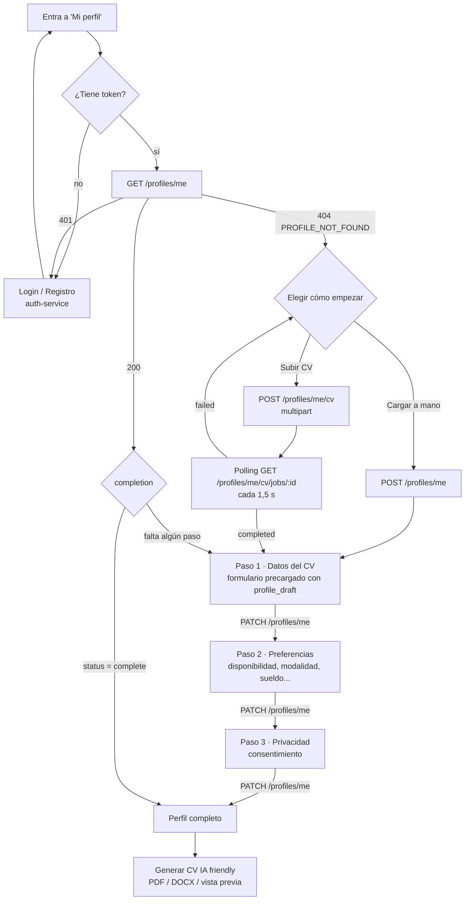

# Contrato frontend ↔ profile-service · Perfil del estudiante y CV

> **Para:** quien desarrolla el frontend (Integrante 4).
> **Servicio:** `profile-service` v0.2.0. Fuente de verdad: [`profile_service.openapi.json`](profile_service.openapi.json).
> **Estructura de datos:** [`estructura_comun_perfil_oferta_match.md`](estructura_comun_perfil_oferta_match.md) §4–§5.
> **Base URL:** same-origin detrás del gateway → `/api/v1/profiles` (en dev `http://localhost:8080/api/v1/profiles`).
> **Perfil de empresa:** ver [`company_profile_frontend.md`](company_profile_frontend.md).

---

## 1. Flujo de pantallas



| Situación | Qué muestra el front |
|---|---|
| Sin token o `401` | Pedir login (auth-service). Volver a "Mi perfil" después. |
| `GET /me` → `404 PROFILE_NOT_FOUND` | Dos opciones: **Subir mi CV** (recomendado) o **Cargar mis datos a mano**. |
| `GET /me` → `200` y `completion.status = "draft"` | Retomar en el primer paso con `complete = false` (ver §5). |
| `GET /me` → `200` y `completion.status = "complete"` | Perfil listo. Ofrecer **Generar CV nuevo** (PDF o Word) y editar. |
| `completion.can_generate_cv = true` | Habilitar el botón de CV aunque falten preferencias (sólo pide el paso 1). |
| `has_cv_suggestions = true` | Hay una extracción de IA sin descartar: ofrecer "Ver datos detectados en tu CV". |

Sólo el rol `student` tiene perfil. Con `company` o `admin`, `/me` responde `403 FORBIDDEN`.

---

## 2. Autenticación

- Todas las rutas piden `Authorization: Bearer <access_token>` (el JWT de `POST /api/v1/auth/token`).
- Si el access token vence (`401`), usar `POST /api/v1/auth/token/refresh` y reintentar (lo resuelve el interceptor de `src/api/client.ts`).
- El perfil se identifica por el usuario del token: el front **no** manda `user_id` ni `profile_id` en las rutas `/me`.

---

## 3. Endpoints

| Método y ruta | Para qué | Respuesta OK |
|---|---|---|
| `GET /profiles/me` | Mi perfil + completitud | `200` `ProfileView` |
| `POST /profiles/me` | Crear el perfil a mano (body opcional, mismas secciones que PATCH) | `201` `ProfileView` |
| `PATCH /profiles/me` | Guardar secciones (cada sección enviada se **reemplaza completa**) | `200` `ProfileView` |
| `POST /profiles/me/cv` | Subir el CV (`multipart/form-data`, campo `file`) | `202` `CvJob` |
| `GET /profiles/me/cv/jobs/{job_id}` | Progreso y resultado de la extracción | `200` `CvJob` |
| `GET /profiles/me/cv-suggestions` | Última extracción de IA guardada | `200` `CvResult` |
| `DELETE /profiles/me/cv-suggestions` | Descartar la extracción | `204` |
| `GET /profiles/me/cv.pdf` | CV nuevo en PDF (`?inline=true` para abrir en el navegador) | `200` `application/pdf` |
| `GET /profiles/me/cv.docx` | CV nuevo en Word | `200` `application/vnd.openxmlformats-officedocument.wordprocessingml.document` |
| `GET /profiles/me/cv.html` | Vista previa del CV (mismo diseño que el PDF) | `200` `text/html` |

> No usar desde el front: `GET /profiles` y `GET /profiles/{id}` (internos para matching y admin) ni `/profiles/cv-extract*` (compatibilidad con la página de prueba `/profiles/cv-test`).

---

## 4. `ProfileView` (respuesta de `GET`, `POST` y `PATCH /me`)

Es el perfil de la estructura común §5 más dos campos calculados. Los campos opcionales **sin valor no vienen** en el JSON (no hay `null`).

```json
{
  "id": "prof-ef0b380e927d",
  "user_id": "f110bd46-96c8-4ad1-8bea-9ee3660f0b7a",
  "version": 3,
  "status": "complete",
  "created_at": "2026-11-06T03:31:24+00:00",
  "updated_at": "2026-11-06T03:35:10+00:00",
  "personal": {
    "name": "Lucía Fernández",
    "email": "lucia.ficticia@example.com",
    "phone": "+54 11 5555-0000",
    "location": { "country": "AR", "province": "Buenos Aires", "city": "San Isidro" }
  },
  "headline": "Estudiante de Sistemas · Backend Python",
  "summary": "Desarrolladora backend en formación, con foco en APIs REST.",
  "academic_status": { "institution": "UTN FRBA", "career": "Ingeniería en Sistemas de Información", "current_year": 4, "progress_percent": 70, "student_shift": ["evening"] },
  "target": { "roles": ["Desarrolladora backend"], "areas": [], "seniority": "junior" },
  "work_conditions": {
    "work_schedule": ["part_time"],
    "work_modality": ["hybrid", "remote"],
    "employment_type": ["employee", "internship"],
    "contract_duration": [],
    "weekly_hours": { "min": 20, "max": 30 },
    "shifts": [],
    "availability_start": "immediate",
    "salary": { "min": 600000, "max": 750000, "currency": "ARS", "period": "month", "gross": true, "negotiable": false, "visibility": "on_match", "to_agree": false },
    "willing_to_relocate": false,
    "driver_license": [],
    "work_authorization": []
  },
  "skills": [
    { "name": "Python", "normalized": "python", "level": 4, "category": "hard", "source": "cv_ai", "confirmed": true },
    { "name": "Git", "normalized": "git", "level": 3, "category": "tool", "source": "manual", "confirmed": true }
  ],
  "experience": [
    { "company": "FinTech Ficticia", "role": "Desarrolladora Backend", "start": "2025-03", "end": "actual", "description": "- APIs REST con FastAPI", "skills_used": ["FastAPI"], "months": 21 }
  ],
  "education": [
    { "institution": "UTN FRBA", "degree": "Ingeniería en Sistemas de Información", "level": "university", "status": "in_progress", "start": "2022" }
  ],
  "languages": [{ "name": "Inglés", "normalized": "ingles", "level": "B2" }],
  "certifications": [{ "name": "Curso de Docker Ficticio", "issuer": "Academia Demo", "year": 2025 }],
  "projects": [],
  "links": [{ "type": "github", "url": "https://github.com/lucia-ficticia" }],
  "volunteering": [],
  "references_available": false,
  "visibility": "public_to_companies",
  "job_search_status": "active",
  "consents": { "data_processing": true, "ai_processing": true, "contact_by_email": false, "accepted_at": "2026-11-06T03:35:10+00:00" },
  "cv_files": [{ "stored_filename": "9f1c…e2.pdf", "original_filename": "mi_cv.pdf", "mime_type": "application/pdf", "size_bytes": 74820, "uploaded_at": "2026-11-06T03:32:00+00:00" }],
  "has_cv_suggestions": true,
  "completion": { "…": "ver §5" }
}
```

Campos que **calcula el servicio** (no se mandan, se ignoran si vienen en el formulario): `id`, `user_id`, `version`, `status`, `created_at`, `updated_at`, `skills[].normalized`, `languages[].normalized`, `experience[].months`, `cv_files`, `has_cv_suggestions`, `completion`.

Al guardar, el servicio también:
- reemplaza el nombre de la skill por el del catálogo si lo reconoce (`"python3"` → `"Python"`, `"Postgres"` → `"PostgreSQL"`) y completa `category` si falta;
- unifica skills repetidas (gana la primera);
- pone `consents.accepted_at` si `data_processing = true` y no vino la fecha.

---

## 5. Completitud (`completion`, calculado por reglas)

Mostrarlo con el badge verde **"Calculado por reglas"** (`origin: "RULES"`). No es IA.

```json
"completion": {
  "origin": "RULES",
  "engine_version": "1.0.0",
  "percent": 72,
  "status": "draft",
  "can_generate_cv": true,
  "steps": [
    { "step": "cv", "complete": true, "missing_required": 0, "missing_recommended": 2 },
    { "step": "preferences", "complete": false, "missing_required": 2, "missing_recommended": 1 },
    { "step": "privacy", "complete": false, "missing_required": 1, "missing_recommended": 0 }
  ],
  "missing": [
    { "field": "work_conditions.work_modality", "step": "preferences", "required": true, "message": "Elegí la presencialidad que aceptás (presencial, remota, mixta)" },
    { "field": "personal.phone", "step": "cv", "required": false, "message": "Agregá un teléfono" }
  ]
}
```

| Paso | Obligatorio (`required: true`) | Recomendado |
|---|---|---|
| `cv` | `personal.name`, `personal.email`, `personal.location` (país, provincia y ciudad), `summary`, `skills` (≥ 1), `education` (≥ 1 o `academic_status.career`) | `headline`, `personal.phone`, `experience` (o `projects`), `languages`, `links` |
| `preferences` | `work_conditions.work_modality`, `work_schedule`, `employment_type`, `availability_start` | `target.roles`, `work_conditions.weekly_hours`, `work_conditions.salary` |
| `privacy` | `consents.data_processing = true` | — |

- `status = "complete"` cuando no falta nada obligatorio. Sólo los perfiles completos, visibles y buscando trabajo entran al matching.
- `can_generate_cv = true` cuando el paso `cv` está completo.
- `percent`: obligatorios pesan 2 y recomendados 1. Sirve para la barra de progreso.
- `missing[].field` usa la misma ruta que el formulario: sirve para marcar el campo y mostrar `message`.

---

## 6. Subir el CV y precargar el formulario

### 6.1 Subida

```ts
const form = new FormData();
form.append('file', file); // .pdf, .docx, .doc o .md · máx. 5 MB
const job = await fetch('/api/v1/profiles/me/cv', {
  method: 'POST',
  headers: { Authorization: `Bearer ${token}` }, // NO poner Content-Type: lo arma el navegador
  body: form,
}).then((r) => r.json());
```

- Si el estudiante no tenía perfil, se crea en borrador con el email de su cuenta.
- Respuesta `202`: un `CvJob` con `status: "processing"`.
- Errores: `422 INVALID_CV_FILE` (extensión, MIME, vacío o > 5 MB) con el formato común.

### 6.2 Polling

`GET /profiles/me/cv/jobs/{job_id}` cada **1,5 s** hasta que `status` deje de ser `processing` (la IA tarda entre 10 y 60 s).

```json
{
  "job_id": "cvjob-28b5e7380371",
  "status": "processing",
  "stage": "Estructurando competencias, experiencia, educación e idiomas con Agente IA…",
  "step_index": 3,
  "progress_percent": 54,
  "elapsed_seconds": 12.4,
  "profile_id": "prof-ef0b380e927d",
  "filename": "mi_cv.pdf",
  "result": null,
  "error": null
}
```

- `progress_percent`, `stage` y `step_index` (1–4) sirven para la barra de progreso.
- `status: "failed"` → `error: {code, message, details}`; ofrecer reintentar o cargar a mano. Ej.: `CV_WEBHOOK_ERROR` si n8n no responde.
- Un `job_id` de otro usuario responde `404`.

### 6.3 Resultado (`status: "completed"`)

`result` (también disponible en `GET /profiles/me/cv-suggestions`) es contenido de IA: mostrarlo con el badge ámbar **"Sugerido por IA"** y el `disclaimer`.

```json
"result": {
  "origin": "AI",
  "model": "nvidia/nemotron-3-ultra-550b-a55b",
  "prompt_version": "1.1.0",
  "generated_at": "2026-11-06T03:32:30+00:00",
  "verified": true,
  "disclaimer": "Sugerencias extraídas automáticamente por IA del CV subido…",
  "file": { "filename": "mi_cv.pdf", "format": "pdf", "size_bytes": 74820 },
  "cv_suggestions": { "…": "forma cv_standard, tal como la devolvió n8n" },
  "profile_draft": {
    "personal": {
      "name": "Lucía Fernández",
      "email": "lucia.ficticia@example.com",
      "phone": "COMPLETAR_MANUALMENTE",
      "location": { "country": "AR", "province": "Buenos Aires", "city": "San Isidro" }
    },
    "headline": "COMPLETAR_MANUALMENTE",
    "summary": "Desarrolladora backend con Python, FastAPI y Docker.",
    "skills": [
      { "name": "Python", "normalized": "python", "level": 4, "category": "hard", "source": "cv_ai", "confirmed": false },
      { "name": "Docker", "normalized": "docker", "level": "COMPLETAR_MANUALMENTE", "category": "tool", "source": "cv_ai", "confirmed": false }
    ],
    "experience": [
      { "company": "FinTech Ficticia", "role": "Desarrolladora Backend", "start": "2024-03", "end": "actual", "description": "- Microservicios REST", "skills_used": ["FastAPI", "PostgreSQL"] }
    ],
    "education": [
      { "institution": "Universidad Tecnológica Nacional", "degree": "Ingeniería en Sistemas de Información", "level": "university", "status": "in_progress" }
    ],
    "languages": [{ "name": "Inglés", "normalized": "ingles", "level": "B2" }],
    "certifications": [{ "name": "Curso de Docker Ficticio" }],
    "links": [{ "type": "github", "url": "https://github.com/lucia-ficticia" }],
    "academic_status": { "institution": "Universidad Tecnológica Nacional", "career": "Ingeniería en Sistemas de Información" }
  },
  "review_fields": ["personal.phone", "headline", "skills[1].level"],
  "received_at": "2026-11-06T03:32:31+00:00"
}
```

Cómo usarlo:

1. **Precargar el formulario del paso 1 con `profile_draft`**, que ya tiene la forma del PATCH: país ISO, enums válidos, fechas `YYYY-MM` y skills normalizadas.
2. **`"COMPLETAR_MANUALMENTE"`** marca un dato que la IA no encontró. Mostrar el campo vacío y resaltado; `review_fields` lista esas rutas.
3. Cada ítem sugerido (skill, experiencia, idioma…) se puede **aceptar, editar o descartar**. Al aceptar una skill, mandar `source: "cv_ai"`; las que agrega el usuario van con `source: "manual"`.
4. Guardar con `PATCH /profiles/me`. **Si queda algún `"COMPLETAR_MANUALMENTE"` en lo enviado, el servicio responde `422`** con las rutas en `details.fields`.
5. La extracción **nunca pisa** el perfil: sólo se guarda lo que el usuario confirma con PATCH.
6. Si el usuario elige "No usar estos datos": `DELETE /profiles/me/cv-suggestions`.

Datos que el CV no trae y se piden siempre en el paso 2: presencialidad, modalidad horaria, tipo de empleo, disponibilidad, sueldo pretendido, horas, turnos, etc.

---

## 7. Guardar (`PATCH /profiles/me`)

- Mandar **sólo las secciones que cambian**. Cada sección enviada **se reemplaza entera**: si mandás `personal`, mandá todos sus campos (si omitís `phone`, se borra). Las listas (`skills`, `experience`…) también se reemplazan completas.
- Secciones editables: `personal`, `headline`, `summary`, `academic_status`, `target`, `work_conditions`, `skills`, `experience`, `education`, `languages`, `certifications`, `projects`, `links`, `volunteering`, `references_available`, `visibility`, `job_search_status`, `consents`, `inclusion`.
- Campos desconocidos → `422` (`extra_forbidden`).

Ejemplo del paso 2 (preferencias):

```json
{
  "target": { "roles": ["Desarrolladora backend"], "seniority": "junior" },
  "work_conditions": {
    "work_schedule": ["part_time"],
    "work_modality": ["hybrid", "remote"],
    "hybrid_onsite_days": 2,
    "employment_type": ["employee", "internship"],
    "weekly_hours": { "min": 20, "max": 30 },
    "shifts": ["morning", "afternoon"],
    "availability_start": "immediate",
    "max_commute_km": 25,
    "salary": { "min": 600000, "max": 750000, "currency": "ARS", "period": "month", "negotiable": true, "visibility": "on_match" }
  }
}
```

Paso 3 (privacidad): `{ "consents": { "data_processing": true, "ai_processing": true, "contact_by_email": false } }`.

### 7.1 Validaciones (las mismas conviene hacerlas con Zod en el front)

| Campo | Regla |
|---|---|
| `personal.name` | 2–120 caracteres |
| `personal.email` | email válido |
| `personal.phone` | 6–30 caracteres: dígitos, espacios, `+ - ( )` |
| `personal.birth_year` | 1940–2015 (opcional; no sale en el CV) |
| `personal.location.country` | ISO-3166 alfa-2 en mayúsculas (`AR`) |
| `skills[].level` | entero 1–5 (máx. 60 skills) |
| `experience[].start` / `education[].start` / `end` | `YYYY` o `YYYY-MM`; `experience[].end` también acepta `"actual"` |
| `academic_status.progress_percent` | 0–100 · `current_year` 1–8 |
| `work_conditions.hybrid_onsite_days` | 0–5 |
| `work_conditions.weekly_hours` | `1 ≤ min ≤ max ≤ 80` |
| `work_conditions.salary` | si `to_agree = false`: `min`, `currency` y `period` obligatorios y `max ≥ min`. Con `to_agree = true` no hace falta monto ("A convenir") |
| URLs (`links`, `projects`, `certifications`) | `http://` o `https://` |
| `summary` | máx. 2000 · `headline` máx. 140 · descripciones máx. 4000 |

`inclusion` (certificado de discapacidad, necesidades de accesibilidad) es **opcional y privado**: sólo lo ve el estudiante, no va al CV, ni a empresas ni a la IA. Pedir consentimiento explícito antes de mostrar ese bloque.

---

## 8. Generar el CV "IA friendly" (PDF o Word)

Disponible cuando `completion.can_generate_cv = true`; si no, `409 PROFILE_INCOMPLETE` con `details.missing`. Se arma **por reglas** con lo que el estudiante confirmó (no usa IA ni inventa nada) y siempre refleja el último guardado.

**Diseño:** moderno y profesional, A4, una columna, tipografía Inter y un color de acento. Lo pueden leer bien los ATS y los filtros con IA:
- todo el contenido es texto real (sin imágenes, tablas ni columnas), con títulos estándar en este orden: Perfil profesional, Competencias, Experiencia, Proyectos, Educación, Idiomas, Certificaciones, Voluntariado;
- niveles explícitos ("Python (Avanzado)", "Inglés — B2 · Intermedio alto") y fechas uniformes ("mar. 2025 – Actualidad");
- metadatos del archivo con autor y palabras clave (skills, puestos buscados e idiomas); el PDF es etiquetado (PDF/UA) y el Word usa estilos nativos (Título, Encabezado 1, Viñetas).

No incluye: año de nacimiento, datos de inclusión, sueldo pretendido ni consentimientos. Incluye email, teléfono, ciudad/provincia/país, links y una línea de **Disponibilidad** (modalidad, horario, tipo de empleo, inicio).

Las descargas necesitan el header `Authorization`, así que no sirve un `<a href>` directo:

```ts
async function downloadCv(format: 'pdf' | 'docx') {
  const res = await fetch(`/api/v1/profiles/me/cv.${format}`, {
    headers: { Authorization: `Bearer ${token}` },
  });
  if (!res.ok) throw await res.json(); // 409 PROFILE_INCOMPLETE → mostrar details.missing
  const name = /filename="(.+)"/.exec(res.headers.get('Content-Disposition') ?? '')?.[1] ?? `CV.${format}`;
  const url = URL.createObjectURL(await res.blob());
  const a = Object.assign(document.createElement('a'), { href: url, download: name });
  a.click();
  URL.revokeObjectURL(url);
}
```

- Nombre del archivo: `CV_Nombre_Apellido.pdf` / `.docx` (sin acentos).
- **Vista previa:** `GET /profiles/me/cv.html` → `<iframe sandbox srcdoc={html}>` (el HTML es autocontenido).
- El PDF también se puede abrir en otra pestaña con `GET /profiles/me/cv.pdf?inline=true` (vía blob URL).

---

## 9. Enums y etiquetas sugeridas (es-AR)

| Enum | Valor → etiqueta |
|---|---|
| `work_schedule` | `full_time` Full time · `part_time` Part time · `hourly` Por horas · `flexible` Flexible |
| `work_modality` | `onsite` Presencial · `remote` Remota · `hybrid` Mixta / híbrida |
| `employment_type` | `employee` Relación de dependencia · `freelance` Freelance · `internship` Pasantía · `trainee` Programa trainee |
| `contract_duration` | `permanent` Indeterminado · `fixed_term` Plazo fijo · `project` Por proyecto · `seasonal` Temporada |
| `availability_start` | `immediate` Inmediata · `within_15_days` En 15 días · `within_30_days` En 30 días · `to_agree` A convenir |
| `shift` | `morning` Mañana · `afternoon` Tarde · `evening` Vespertino · `night` Noche · `weekend` Fin de semana · `rotating` Rotativo |
| `seniority` | `no_experience` Sin experiencia · `trainee` Trainee · `junior` Junior · `semi_senior` Semi senior · `senior` Senior |
| `skill level` | 1 Inicial · 2 Básico · 3 Intermedio · 4 Avanzado · 5 Experto |
| `skill category` | `hard` Técnica · `tool` Herramienta · `methodology` Metodología · `soft` Interpersonal |
| `language level` | `A1`…`C2` (MCER) · `native` Nativo |
| `education level` | `secondary` Secundario · `tertiary` Terciario · `university` Universitario · `postgraduate` Posgrado · `course` Curso |
| `education status` | `in_progress` En curso · `completed` Completo · `incomplete` Incompleto |
| `currency` / `period` | `ARS`, `USD` · `hour` por hora · `day` por día · `month` por mes · `year` por año · `project` por proyecto |
| `salary.visibility` | `public` Visible para empresas · `on_match` Sólo si hay match · `hidden` Oculto (sólo lo usa el motor) |
| `travel_availability` | `none` No · `occasional` Ocasional · `frequent` Frecuente |
| `invoicing_status` | `monotributo` · `responsable_inscripto` · `none` No factura · `to_register` Puede inscribirse |
| `link type` | `linkedin` · `github` · `portfolio` · `other` |
| `visibility` (perfil) | `public_to_companies` Visible para empresas · `only_applied` Sólo donde me postulo · `hidden` Oculto |
| `job_search_status` | `active` Buscando · `open_to_offers` Abierto a ofertas · `not_looking` No busco |

---

## 10. Errores

Siempre `{"error": {"code", "message", "details"}}`.

| HTTP | `code` | Cuándo | Qué hacer |
|---|---|---|---|
| 401 | `UNAUTHORIZED` | Sin token, vencido o inválido | Refresh o login |
| 403 | `FORBIDDEN` | Rol distinto de `student` en `/me` | Ocultar la sección |
| 404 | `PROFILE_NOT_FOUND` | Todavía no tiene perfil · job ajeno | Ofrecer CV o carga manual |
| 404 | `CV_SUGGESTIONS_NOT_FOUND` | No hay extracción guardada | — |
| 404 | `CV_JOB_NOT_FOUND` | `job_id` inexistente (p. ej. reinicio del servicio) | Volver a subir |
| 409 | `PROFILE_ALREADY_EXISTS` | `POST /me` con perfil existente | Usar `PATCH` |
| 409 | `PROFILE_INCOMPLETE` | Generar CV sin el paso 1 completo | Mostrar `details.missing` |
| 422 | `INVALID_INPUT` | Validación (`details.errors[].loc` = ruta del campo) o `COMPLETAR_MANUALMENTE` sin reemplazar (`details.fields`) | Marcar campos |
| 422 | `INVALID_CV_FILE` | Archivo no permitido o > 5 MB | Mensaje junto al input |
| 422 | `UNSUPPORTED_FORMAT` | Formato de CV desconocido | — |

Ejemplo de `422` de validación:

```json
{ "error": { "code": "INVALID_INPUT", "message": "Datos de entrada inválidos",
  "details": { "errors": [ { "loc": ["body", "work_conditions", "work_modality", 0], "msg": "Input should be 'onsite', 'remote' or 'hybrid'", "type": "enum" } ] } } }
```

---

## 11. Cambios necesarios en el frontend actual

| Hoy (`src/services/profileService.ts`) | Con este contrato |
|---|---|
| `updateProfile` hace `PUT /profiles/me` | Usar **`PATCH /profiles/me`** con las secciones del paso |
| `uploadCV` espera `{message, filename}` | Responde **`202` con un `CvJob`**: hacer polling (§6.2) y precargar con `result.profile_draft` |
| `getProfile` con 404 tira error genérico | Tratar `404 PROFILE_NOT_FOUND` como "sin perfil" (§1) |
| `StudentProfile` en `src/types/profile.ts` | Sumar `id`, `version`, `status`, `completion`, `has_cv_suggestions`, `cv_files`, `projects`, `links`, `consents`; `skills[].normalized` lo calcula el servicio (opcional al enviar) |
| `api.ts` lee `errorData.detail` | El error viene en `errorData.error.message` (y `details`) |
| — | Botones "Descargar CV (PDF)" y "Descargar CV (Word)" + vista previa (§8) |
