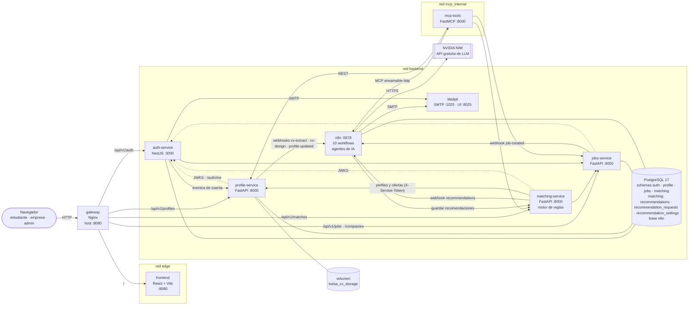
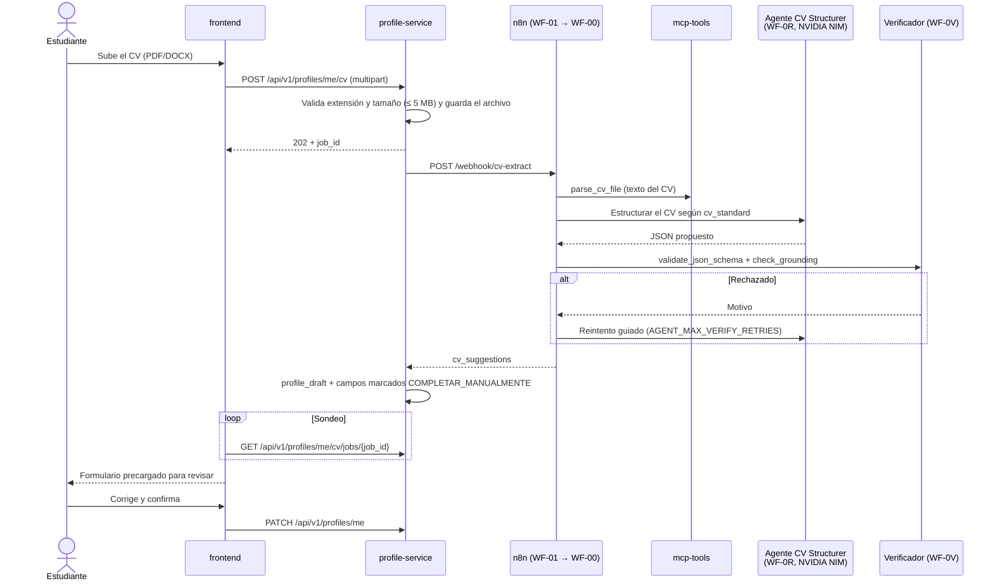
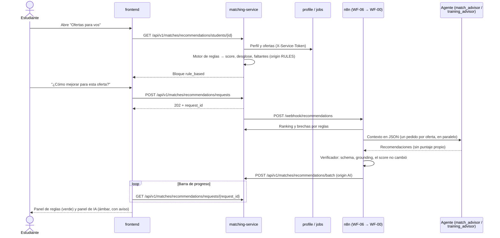
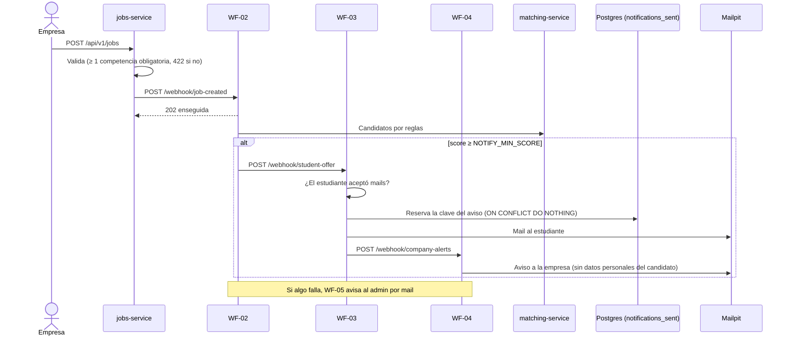

# Arquitectura y comunicación entre componentes

> Bolsa de Trabajo · MVP · Grupo 1. Los diagramas están en Mermaid: GitHub los dibuja directamente al abrir este archivo.

## 1. Vista general

Microservicios REST detrás de un API Gateway, con la IA y las automatizaciones concentradas en n8n. Todo corre con **Docker Compose** (`docker-compose.yml`), salvo los modelos de lenguaje, que se consumen desde la API gratuita de NVIDIA NIM.

Líneas llenas: pedidos de negocio. Punteadas: validación del JWT (cada servicio descarga la clave pública de `auth-service` y valida el token localmente).

## 2. Responsabilidad de cada componente

| Componente | Entrada | Salida | Persistencia |
|---|---|---|---|
| `frontend` | Acciones del usuario | Pedidos JSON a `/api/v1/*` con `Authorization: Bearer` | Sólo sesión en el navegador |
| `gateway` | Todo el tráfico del host en `:8080` | Lo reparte por ruta; en `/api/v1/auth/login` limita la tasa de pedidos | — |
| `auth-service` | Registro, login, cambios de clave/correo, admin | JWT RS256 (15 min) + refresh token (7 días), mails, eventos `account.deleted`/`account.updated` | Schema `auth` (usuarios, empresas, sesiones, outbox de eventos) |
| `profile-service` | Perfil, CV (PDF/DOCX/DOC/MD ≤ 5 MB), logo de empresa | Perfil con completitud, borrador de la IA, CV generado en PDF/DOCX/HTML | Schema `profile` + volumen `bolsa_cv_storage` |
| `jobs-service` | Ofertas de empresas | Ofertas paginadas, detalle, evento `job.created` | Schema `jobs` |
| `matching-service` | `profile_id` + `job_id` | Puntaje por reglas con desglose, faltantes, rankings, pedidos a la IA y vistas reglas + IA | Schema `matching` (PostgreSQL): tablas `recommendations`, `recommendation_requests` y `recommendation_settings`, creadas al iniciar el servicio; los puntajes por reglas se recalculan |
| `n8n` | Webhooks de los servicios | Respuestas de la IA verificadas, mails, avisos de error | Base `n8n` (workflows, ejecuciones) y tabla `bolsa.notifications_sent` |
| `mcp-tools` | Llamadas MCP de n8n (`X-Service-Token`) | Texto del CV, rankings, validación de schema, grounding, modelo a usar | — |

## 3. Puertos y redes

| Servicio | Puerto interno | Publicado en el host | Redes |
|---|---|---|---|
| `gateway` | 8080 | `${GATEWAY_PORT:-8080}` | `edge`, `backend` |
| `frontend` | 8080 | — | `edge` |
| `auth-service` | 3000 | — | `backend` |
| `profile-service` | 8000 | — | `backend` |
| `jobs-service` | 8000 | — | `backend` |
| `matching-service` | 8000 | — | `backend` |
| `n8n` | 5678 | `${N8N_PORT:-5678}` | `backend`, `mcp_internal` |
| `mcp-tools` | 8000 (`/mcp`, `/router/*`) | — | `backend`, `mcp_internal` |
| `postgres` | 5432 | `${POSTGRES_HOST_PORT:-5432}` (sólo en desarrollo) | `backend` |
| `mail` | 1025 (SMTP), 8025 (UI) | `${MAIL_UI_PORT:-8025}` | `backend` |

- Dentro de Docker los servicios se llaman por nombre (`http://matching-service:8000`, `http://n8n:5678/webhook`), nunca por `localhost`.
- `edge` separa el front de los servicios: el front sólo habla con el gateway.
- `mcp_internal` es el canal exclusivo n8n ↔ `mcp-tools`; `mcp-tools` **no pasa por el gateway** y no se publica en el host.
- Las llamadas entre servicios y a los webhooks de n8n llevan el header `X-Service-Token` (valor en `.env`).

## 4. Recorrido de los datos

### 4.1 Alta del perfil desde el CV (IA + supervisión humana)

La IA sólo propone un **borrador**: nada se guarda en el perfil hasta que el estudiante lo revisa y confirma.

### 4.2 Puntaje por reglas y recomendaciones de IA

### 4.3 Oferta nueva → avisos por mail

## 5. Workflows de n8n

| Workflow | Disparador | Qué hace | Decisiones (nodos IF/Switch) |
|---|---|---|---|
| `WF-00` Orquestador | Sub-workflow / webhook `orquestador` | Lee el adjunto por MCP, llama al especialista y al verificador, reintenta | 3 |
| `WF-0R` Agente y Router NVIDIA | Sub-workflow / webhooks internos | Elige modelo (cuota por minuto, circuit-breaker) y ejecuta el agente | Switch + 2 IF |
| `WF-0V` Verificador | Sub-workflow | JSON Schema + grounding + integridad del puntaje + agente verificador | 1 |
| `WF-01` Procesar CV | `POST /webhook/cv-extract` | Agente CV Structurer | 2 |
| `WF-02` Oferta nueva | `POST /webhook/job-created` | Busca estudiantes compatibles | 1 |
| `WF-03` Mails a estudiantes | `POST /webhook/profile-updated`, `/student-offer` | Resumen y aviso de oferta nueva | 2 |
| `WF-04` Aviso a empresas | `POST /webhook/company-alerts` | Candidato nuevo compatible | 1 |
| `WF-05` Errores | *Error trigger* de todos los demás | Mail al admin, sin repetir avisos | Filtro en código |
| `WF-06` Recomendador | `POST /webhook/recommendations` | `student`, `company` y `training` | 2 |
| `WF-07` Diseño del CV | `POST /webhook/cv-design` | Agente CV Designer elige el diseño | 1 |

Los JSON están en `n8n/workflows/`, se generan con `python n8n/generate_workflows.py` desde `n8n/agentes/` y `n8n/prompts/`, y n8n los importa y activa en cada arranque (`n8n/init/bootstrap.sh`).

## 6. Reglas frente a IA

| | Por reglas (`origin: "RULES"`) | Por IA (`origin: "AI"`) |
|---|---|---|
| Dónde | `matching-service` (`app/domain/engine.py`, `scoring_rules.yaml`) | Agentes en n8n |
| Qué produce | Puntaje 0–100, desglose por criterio, faltantes, condiciones, rankings | Formación sugerida, consejos de perfil, análisis de candidatos, borrador del CV, diseño del CV |
| Pesos | Obligatorias 40 · experiencia 25 · deseables 10 · niveles 10 · formación 5 · condiciones 7 · idiomas 3. Falta una excluyente → tope 40. Sin licencia o permiso de trabajo → incompatible | — |
| Control | Tests unitarios (128 en matching) | Verificador: schema, grounding (no puede nombrar competencias que no están en los datos) y el puntaje tiene que coincidir con el del motor |
| En pantalla | Badge verde | Badge ámbar con aviso, modelo, versión del prompt y fecha |

## 7. Decisiones técnicas y límites conocidos

- **Sin servicio intermedio de IA:** toda la orquestación de agentes vive en n8n para aprovechar sus nodos de agente, memoria y cliente MCP, y para que el docente pueda ver cada ejecución.
- **NVIDIA NIM** como proveedor: API gratuita del NVIDIA Developer Program, compatible con OpenAI, pensada para prototipos; el límite (~40 pedidos por minuto por key) lo administra el router de `mcp-tools`. Se decidió no usar modelos locales con Ollama (P-004). Ver la justificación completa en [BITACORA_IA.md](BITACORA_IA.md).
- **PostgreSQL con un rol y un schema por servicio:** ningún servicio puede leer los datos de otro; se comunican por REST.
- **JWT RS256 con JWKS:** sólo `auth-service` tiene la clave privada; los demás validan con la pública.
- **Volúmenes externos:** los datos sobreviven a `docker compose down -v`.
- **Persistencia de matching:** las recomendaciones de IA, los estados de sus pedidos y la configuración del admin se guardan en PostgreSQL, schema `matching`. Los rankings y puntajes por reglas se recalculan al consultar.
- **Versiones de imágenes:** `n8n` está fijado en `2.45.7` (los workflows usan nodos de n8n 2.x y en 1.x no se publican) y Mailpit en `v1.33.1` para evitar cambios inesperados al reconstruir el entorno.
